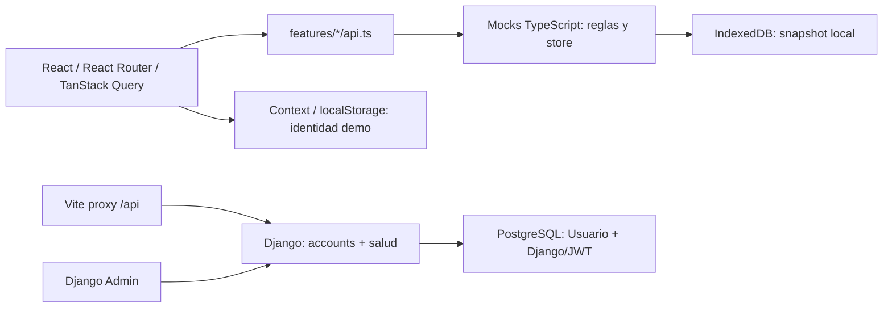
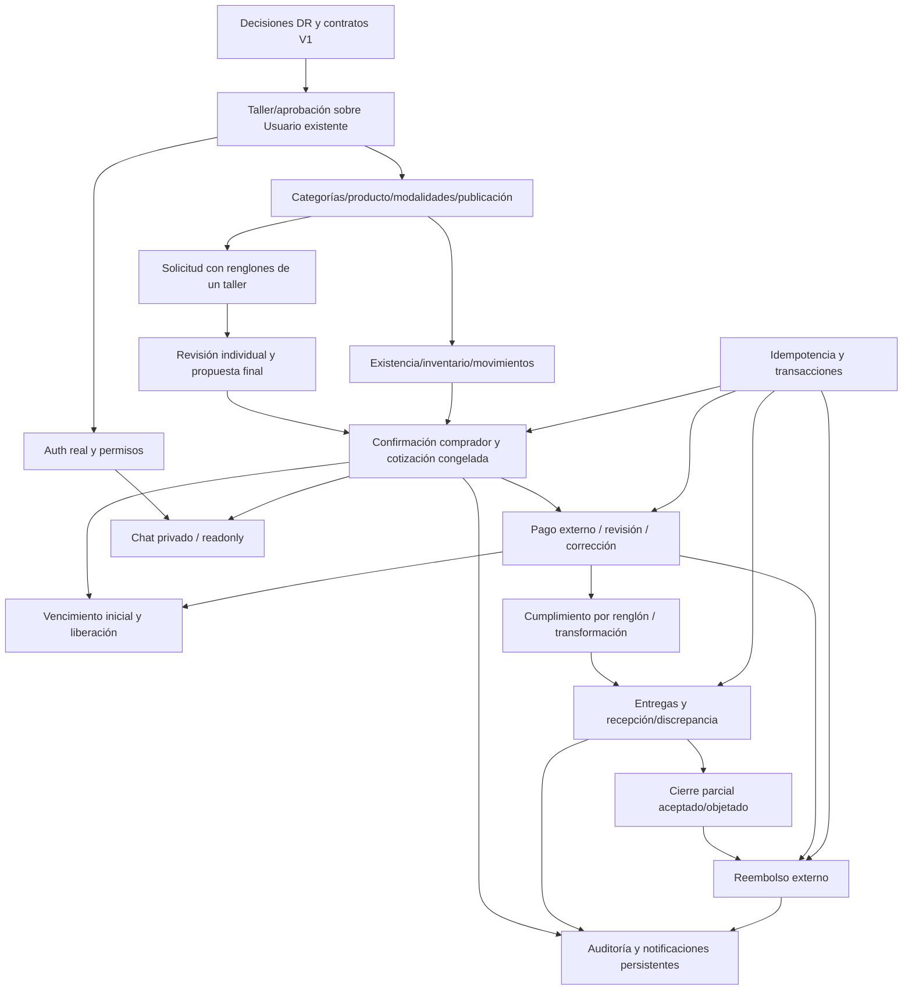

# Auditoría técnica de ArtesaNic contra V1 — 12 de octubre de 2026

## 1. Resumen ejecutivo

**Conclusión ejecutiva: el working tree actual no implementa la nueva V1 de forma integral.** Hay una SPA de demostración amplia y un backend real de cuentas; la base de datos no contiene el dominio comercial. La prioridad es representar solicitudes con renglones, propuesta final del artesano y confirmación del comprador en servicios de backend, antes de conectar las pantallas existentes.

**HECHO:** las seis fronteras API de features son reexportaciones de mocks o constantes demo; no son clientes HTTP de negocio. **HECHO:** el único modelo propio de Django es `Usuario`. **HECHO:** PostgreSQL activo contiene 12 tablas y ninguna de producto/pedido/pago/inventario. **INFERENCIA:** cambiar mocks por HTTP conservando sus firmas reproduciría el modelo comercial antiguo, en vez de implementar la nueva V1.

Brechas centrales:

- RF-005/009/018: `Order` representa un único producto; no existen renglones, resoluciones individuales ni propuesta pendiente de aceptación final del comprador.
- RF-006/022 y RN-011: el artesano acepta globalmente y reserva/congela de inmediato en el mock. La nueva reserva ocurre al confirmar el comprador.
- RF-004 y RN-002: el backend registra al artesano activo y emite sesión sin aprobación; no existe taller persistente ni estado de aprobación.
- RF-015: el comprador solo cancela desde Aceptado en el código. No existen vencimiento automático inicial, cierre parcial ni reembolsos.
- RN-023/024: transformar no consume la unidad base; cancelar antes de producción envía todas las unidades a clasificación.
- RF-020/023: notificaciones son únicamente de chat y volátiles; movimientos de inventario no tienen UI consumidora.
- RNF-011/014/015: cola y rollback de un proceso JavaScript no son autoridad, locking, idempotencia ni transacciones comerciales PostgreSQL.

Ninguno de los **21 RF activos** tiene evidencia de todas las capas exigidas para un flujo realmente implementado. Esto no equivale a descartar la UI, la autenticación Django o sus pruebas útiles. RF-002 está integrado; RF-012 y RF-024 están fuera de V1 y no se encontró código de pasarela/valorización incorporado indebidamente.

**Alcance:** diagnóstico y backlog propuesto. No se modificaron código, configuración, dependencias, modelos, endpoints, migraciones ni documentos existentes. No hubo commits, ramas, PR, publicación de issues o ejecución de soluciones.

## 2. Estado del repositorio auditado

- Raíz: `C:\Users\yader\ProyectoFinal\Front-ArtesaNic`.
- Rama: `develop`.
- HEAD: `625b4d581e20843dd70619c28f567bbb8a08d490`, “Merge pull request #5 from Luigui789/refactor/frontend-por-dominio”.
- Se audita el **working tree local**, incluyendo la nueva documentación no confirmada en Git; no se presume que esté en GitHub.
- Baseline única: [requisitos](../requisitos/requisitos.md), [RN](../requisitos/reglas-de-negocio.md), [módulos](../requisitos/modulos-y-reglas.md) y [guía](../requisitos/guia-alcance.md). **21 RF activos, 15 RNF activos, 24 RN**. Activo no significa implementado.
- Fuentes antiguas no sustituyen esta baseline. El texto adjunto de la solicitud aclara el plazo inicial después de confirmar y el inicio de corrección al observar; detalles de reloj/límites/resolución siguen abiertos.
- Backend disponible en `apps/backend`; no aplica BACKEND_NOT_AVAILABLE.

Cambios locales encontrados antes de la auditoría:

```text
M README.md
M docs/README.md
M docs/requisitos/guia-alcance.md
M docs/requisitos/modulos-y-reglas.md
M docs/requisitos/requisitos.md
?? docs/requisitos/historico/fichas-2026-10-08.md
?? docs/requisitos/historico/guia-alcance-2026-10-08.md
?? docs/requisitos/historico/modulos-2026-10-08.md
?? docs/requisitos/reglas-de-negocio.md
?? docs/trazabilidad/actualizacion-requisitos-2026-10-12.md
```

### Método y límites

HECHO = lectura directa de código/configuración o resultado observado. INFERENCIA = conclusión razonada, identificada expresamente. NO VERIFICADO = evidencia insuficiente. La clasificación principal usa exclusivamente KEEP, ADAPT, REFACTOR, REBUILD, REMOVE, NOT_IMPLEMENTED, NOT_VERIFIED y DECISION_REQUIRED. “Parcial” en descripciones indica capas existentes, no una clasificación nueva.

Las pruebas mutantes se limitaron al store RAM del proceso Node del script existente. Las diez pruebas Django ejecutadas son `SimpleTestCase` sin creación de BD de pruebas. No se ejecutó la suite PostgreSQL completa: crea/destruye `test_*`. No se ejecutó build, instalación, format, migración, flush, dump ni restore. La inspección SQL utilizó `BEGIN READ ONLY` y `ROLLBACK`, sin leer valores privados de usuarios/tokens. Se conservaron servicios y volumen activos.

| Verificación ejecutada | Resultado y límite |
|---|---|
| `docker compose ps` | Tres servicios saludables: db/backend/frontend; salud de proceso no demuestra V1 |
| `python -B manage.py check` | 0 problemas de configuración Django |
| `node ../../infra/scripts/check-health.mjs` en frontend | GET frontend → backend devuelve estado ok; no E2E de negocio ni prueba BD |
| `pnpm typecheck` en frontend Docker | Pasa, sin emisión de archivos |
| `tsc.cmd --noEmit` en Windows fuera del aislamiento | Pasa, 0 errores. Dentro del aislamiento devuelve 293 diagnósticos de tipos; no se reprodujeron en ejecución normal ni Docker |
| `pnpm exec eslint .` sin fix/cache | 0 errores, 9 advertencias react-refresh; no se corrigieron |
| `node scripts/check-demo.mjs` | Pasa; prueba mocks en RAM y varios comportamientos anteriores |
| `python -B manage.py test apps.accounts.tests.test_phone_normalization config.tests.test_health config.tests.test_openapi` | 10 pruebas pasan; no autentican flujos comerciales ni prueban aprobación/inventario |
| `python -B infra/scripts/check-secrets.py` en host | 248 archivos actuales y 487 blobs Git sin coincidencias; escaneo por patrones, no certificación exhaustiva |
| `python -B infra/scripts/check-doc-links.py` en host, antes de crear informe | 377 enlaces y 48 documentos, sin errores |
| SQL de tablas, columnas, migraciones, constraints e índices | 12 tablas; solo accounts como dominio propio; constraints de Usuario presentes |
| Navegador IAB contra Docker, sin enviar formularios | 14 rutas observadas; contenido cargado de 13 y acceso estático. 360/768/1366 px sin overflow horizontal observado; 0 imágenes rotas en muestra cargada; sin errores/warnings capturados |
| Control principal “Registrar pago” | 36 px alto a 360 px, contrario al mínimo de 44 px de RNF-001 |

La primera pasada de cuatro detalles mostró skeletons; se repitieron tras esperar contenido cargado. No se usa esa primera observación para afirmar cumplimiento responsive. No se probaron inputs adversos/strings largos, todas las interacciones táctiles, los últimos dos navegadores soportados, carga P95, pérdidas de respuesta reales ni dos usuarios/dispositivos. Se intentó el scanner en el contenedor backend, donde no existe la ruta `infra/scripts`; se ejecutó correctamente en el host. No confundir ese intento fallido con un fallo de seguridad del producto.

**Diferencia de entorno del typecheck:** HECHO: TypeScript 5.9.3, React 19.2.8 y @types/react 19.2.18 coinciden en host y Docker; Node es 22.16.0 en Windows y 22.23.3 en Docker. La ejecución Windows aislada falla, pero Windows sin aislamiento y Docker pasan sobre el mismo código. INFERENCIA: la divergencia corresponde al entorno de ejecución/acceso/resolución de dependencias; su mecanismo exacto es NO VERIFICADO y no se presenta como un bug de producto. Una consulta auxiliar a package.json de Radix no es compatible con sus exports y falló en ambos entornos; no se usa ese intento para diagnosticar el funcionamiento de Radix.

**Preservación final:** se compararon hashes SHA-256 de los archivos existentes antes de redactar y después de guardar el informe: ninguno cambió. El único archivo añadido por esta auditoría es este informe. El checker documental posterior pasó con 922 enlaces internos y 49 documentos; no se repararon documentos ajenos al informe.

## 3. Arquitectura encontrada



No hay flecha de API comercial entre UI y Django: no se encontró cliente HTTP de dominio. La única comunicación técnica acreditada es la sonda a través de Vite. El backend es monolito modular inicial, no servicio de pedidos ya existente.

### Registro de evidencia

Las referencias siguientes tienen números de línea obtenidos del árbol local; los archivos no se editaron durante la auditoría. Cada código E enlaza un archivo concreto y un símbolo. Las referencias en matrices y fichas remiten a este registro.

| Evidencia | Archivo y línea | Símbolo / hecho |
|---|---|---|
| <a id="e01"></a>E01 | [apps/frontend/src/app/App.tsx](../../apps/frontend/src/app/App.tsx):26 | `App/queryClient/Routes`: 14 páginas y fallback; providers; sin guards |
| <a id="e02"></a>E02 | [apps/frontend/src/types/index.ts](../../apps/frontend/src/types/index.ts):9 | `Category/Artisan/Product/Order`: Entidades exclusivamente TypeScript; Order singular en línea 225 |
| <a id="e03"></a>E03 | [apps/frontend/src/features/auth/use-session.tsx](../../apps/frontend/src/features/auth/use-session.tsx):23 | `COMPRADOR/ARTESANO/SessionProvider`: Identidad local, mismo ID, rol alternable, auto comprador |
| <a id="e04"></a>E04 | [apps/frontend/src/features/auth/pages/acceso.tsx](../../apps/frontend/src/features/auth/pages/acceso.tsx):64 | `entrar`: Valida formato e ingresa sesión simulada |
| <a id="e05"></a>E05 | [apps/frontend/src/features/catalogo/api.ts](../../apps/frontend/src/features/catalogo/api.ts):6 | `api de features`: Reexporta mocks; equivalentes en talleres/pedidos/pagos/mensajes |
| <a id="e06"></a>E06 | [apps/frontend/src/mocks/catalogo.ts](../../apps/frontend/src/mocks/catalogo.ts):22 | `listProducts/validateProduct/createProduct/updateProduct/processImage`: Filtros en RAM; stock requerido; imagen DataURL; sin despublicación |
| <a id="e07"></a>E07 | [apps/frontend/src/mocks/pedidos.ts](../../apps/frontend/src/mocks/pedidos.ts):43 | `createOrderRequest/changeOrderStatus`: Pedido singular; aceptación global reserva y congela en 163; entrega/cancelación en 191 |
| <a id="e08"></a>E08 | [apps/frontend/src/mocks/pagos.ts](../../apps/frontend/src/mocks/pagos.ts):9 | `registerPayment/correctPayment/reviewPayment/getPaymentReceipt`: Intentos y revisión simulados; corrección en 67 y privacidad simulada en 143 |
| <a id="e09"></a>E09 | [apps/frontend/src/mocks/mensajes.ts](../../apps/frontend/src/mocks/mensajes.ts):7 | `listMessages/sendMessage/pollNewMessages`: Sin permisos; cursor timestamp > desde en 46 |
| <a id="e10"></a>E10 | [apps/frontend/src/mocks/inventario.ts](../../apps/frontend/src/mocks/inventario.ts):10 | `movement/listUnitMovements/validateQuantity`: Movimientos RAM; cantidad ligada a stock |
| <a id="e11"></a>E11 | [apps/frontend/src/mocks/core.ts](../../apps/frontend/src/mocks/core.ts):30 | `store/api/queue`: Serialización y rollback de una instancia; api en 97; seed en 23 |
| <a id="e12"></a>E12 | [apps/frontend/src/mocks/persistence.ts](../../apps/frontend/src/mocks/persistence.ts):14 | `IndexedDB/instantanea`: Snapshot completo del navegador; versión 2; escrituras en 82 |
| <a id="e13"></a>E13 | [apps/frontend/src/mocks/seed.ts](../../apps/frontend/src/mocks/seed.ts):31 | `buildCategories/buildArtisans/buildProducts/escenarios/buildOrders/buildMessages`: 6 categorías, 50 talleres, 500 productos, 10 escenarios/pedidos y 10 mensajes |
| <a id="e14"></a>E14 | [apps/frontend/src/lib/order-state.ts](../../apps/frontend/src/lib/order-state.ts):8 | `orderFlow/TRANSITIONS/canCancel/chatMode`: Opciones globales; cancelación solo aceptado en 48 |
| <a id="e15"></a>E15 | [apps/frontend/src/lib/order-amounts.ts](../../apps/frontend/src/lib/order-amounts.ts):8 | `orderTotal/orderBreakdown`: Total singular; FrozenQuote en types:206 |
| <a id="e16"></a>E16 | [apps/frontend/src/features/pedidos/pages/panel-pedido-detalle.tsx](../../apps/frontend/src/features/pedidos/pages/panel-pedido-detalle.tsx):378 | `GestionPedido/cambiar`: Artesano acepta y reserva todo; acción entregado global |
| <a id="e17"></a>E17 | [apps/frontend/src/features/pedidos/pages/pedido-detalle.tsx](../../apps/frontend/src/features/pedidos/pages/pedido-detalle.tsx):91 | `DetallePedido/cancelar`: Comprador cancela aceptado; botón en 251 |
| <a id="e18"></a>E18 | [apps/frontend/src/features/pedidos/pages/solicitar.tsx](../../apps/frontend/src/features/pedidos/pages/solicitar.tsx):78 | `SolicitarPedido`: Payload un producto; todas las opciones limitadas por stock |
| <a id="e19"></a>E19 | [apps/frontend/src/features/pagos/components/payment-receipt.tsx](../../apps/frontend/src/features/pagos/components/payment-receipt.tsx):76 | `PaymentPanel/ReceiptImage`: UI pagos externos; habilitación por aceptado; botón Registrar pago en 258 |
| <a id="e20"></a>E20 | [apps/frontend/src/features/pedidos/components/delivery-panel.tsx](../../apps/frontend/src/features/pedidos/components/delivery-panel.tsx):59 | `DeliveryPanel/CancelledUnits`: Costo manual; retiro C$0; clasificación en 249 |
| <a id="e21"></a>E21 | [apps/frontend/src/features/notificaciones/use-notifications.tsx](../../apps/frontend/src/features/notificaciones/use-notifications.tsx):19 | `NotificationsProvider/POLL_MS`: Avisos de chat 20 s; state volátil en 49 |
| <a id="e22"></a>E22 | [apps/frontend/src/features/mensajes/components/order-chat.tsx](../../apps/frontend/src/features/mensajes/components/order-chat.tsx):14 | `OrderChat/POLL_MS`: 15 s; invalida y relee listado; promise sin catch en 45 |
| <a id="e23"></a>E23 | [apps/backend/apps/accounts/models.py](../../apps/backend/apps/accounts/models.py):30 | `Usuario/Rol`: Único modelo propio; checks en 61; puede_usar_api en 93 |
| <a id="e24"></a>E24 | [apps/backend/apps/accounts/services.py](../../apps/backend/apps/accounts/services.py):26 | `registrar_comprador/registrar_artesano/_registrar/autenticar`: Alta atomic en 39; artesano sin aprobación |
| <a id="e25"></a>E25 | [apps/backend/config/urls.py](../../apps/backend/config/urls.py):6 | `urlpatterns`: Solo admin/salud/auth; siete rutas auth en accounts/api/urls.py:7 |
| <a id="e26"></a>E26 | [apps/backend/apps/accounts/api/views.py](../../apps/backend/apps/accounts/api/views.py):92 | `APIView de cuentas`: Sesión en 143; registro artesano en 187; perfil GET en 298 |
| <a id="e27"></a>E27 | [apps/backend/apps/accounts/api/serializers.py](../../apps/backend/apps/accounts/api/serializers.py):11 | `SinCamposDesconocidosMixin/RegistroSerializer/UsuarioSerializer`: Payloads permitidos; perfil read_only en 89 |
| <a id="e28"></a>E28 | [apps/backend/apps/accounts/api/authentication.py](../../apps/backend/apps/accounts/api/authentication.py):15 | `JWTAuthentication`: Valida cuenta activa por petición; CSRF en api/csrf.py:18; cookies en api/tokens.py:49 |
| <a id="e29"></a>E29 | [apps/backend/apps/accounts/api/permissions.py](../../apps/backend/apps/accounts/api/permissions.py):13 | `EsComprador/EsArtesano/EsPropietario`: Primitivas rol/objeto; solo usadas en vistas sintéticas de pruebas |
| <a id="e30"></a>E30 | [apps/backend/apps/accounts/admin.py](../../apps/backend/apps/accounts/admin.py):18 | `UsuarioAdmin`: Tokens retirados de admin; límites administrador plataforma en 81 |
| <a id="e31"></a>E31 | [apps/backend/apps/accounts/migrations/0001_initial.py](../../apps/backend/apps/accounts/migrations/0001_initial.py):18 | `CreateModel Usuario`: Una migración propia; constraints y M2M de cuentas |
| <a id="e32"></a>E32 | [apps/frontend/scripts/check-demo.mjs](../../apps/frontend/scripts/check-demo.mjs):59 | `assertions demo`: Aceptación global; reserva durante transformación en 194; clasificación canceladas en 217 |
| <a id="e33"></a>E33 | [apps/backend/apps/accounts/tests/test_registration.py](../../apps/backend/apps/accounts/tests/test_registration.py):22 | `RegistroTests`: 15 métodos; artesano activo sin aprobar en 49; simultáneo simulado en 73 |
| <a id="e34"></a>E34 | [apps/backend/config/settings/base.py](../../apps/backend/config/settings/base.py):97 | `DATABASES/REST_FRAMEWORK/CACHES/SIMPLE_JWT`: PostgreSQL; auth default en 159; LocMem en 182; access 5 min en 188 |
| <a id="e35"></a>E35 | [docker-compose.yml](../../docker-compose.yml):1 | `db/backend/frontend`: Desarrollo localhost; healthchecks; volúmenes; sin backups/jobs/TLS |
| <a id="e36"></a>E36 | [.github/workflows/integration.yml](../../.github/workflows/integration.yml):19 | `integration`: Solo checks docs/secretos/Compose/salud; no E2E funcional |
| <a id="e37"></a>E37 | [apps/frontend/src/styles.css](../../apps/frontend/src/styles.css):163 | `touch-target`: 44 × 44; button.tsx:22 usa altura base 36 px |
| <a id="e38"></a>E38 | [apps/frontend/src/features/catalogo/pages/catalogo.tsx](../../apps/frontend/src/features/catalogo/pages/catalogo.tsx):68 | `Catalogo`: Filtros, URL, paginación y layout responsive |
| <a id="e39"></a>E39 | [apps/frontend/src/features/talleres/pages/panel-perfil.tsx](../../apps/frontend/src/features/talleres/pages/panel-perfil.tsx):116 | `PerfilTaller/guardar`: Actualiza taller mock; imágenes y datos públicos incompletos |
| <a id="e40"></a>E40 | [apps/frontend/src/lib/format.ts](../../apps/frontend/src/lib/format.ts):2 | `TASA_CAMBIO/formatPrice`: 36.8 hardcodeada; no configuración admin |
| <a id="e41"></a>E41 | [apps/frontend/src/lib/image-files.ts](../../apps/frontend/src/lib/image-files.ts):6 | `IMAGE_TYPES/MAX_IMAGE_BYTES/readAsDataUrl`: JPG/PNG/WebP 5MB actuales; no política vigente cerrada |
| <a id="e42"></a>E42 | [apps/frontend/src/features/catalogo/pages/panel-productos.tsx](../../apps/frontend/src/features/catalogo/pages/panel-productos.tsx):82 | `MisProductos`: Fallback demo; creación/edición; sin despublicar |
| <a id="e43"></a>E43 | [apps/backend/config/health.py](../../apps/backend/config/health.py):13 | `SaludView`: GET estado ok sin comprobar BD |
| <a id="e44"></a>E44 | [apps/frontend/src/features/README.md](../../apps/frontend/src/features/README.md):76 | `instrucciones integración`: Preservar firmas no basta para nueva V1 |
| <a id="e45"></a>E45 | [apps/frontend/src/components/layout/site-layout.tsx](../../apps/frontend/src/components/layout/site-layout.tsx):78 | `SelectorVista/RestablecerDemo`: Roles demo; reset; aviso persistencia en 346 |
| <a id="e46"></a>E46 | [apps/frontend/src/features/catalogo/components/image-uploader.tsx](../../apps/frontend/src/features/catalogo/components/image-uploader.tsx):30 | `ImageUploader/handleFile`: Carga integrada, preview y errors; RF-002 todavía en comentario |

**Seguridad de inferencia:** un comentario que dice “GET /categorias” no acredita ese endpoint. Una entidad TypeScript no acredita tabla PostgreSQL. Un booleano `disponible` no acredita publicación. Una constante de estado no acredita servicio autorizado ni transacción.

## 4. Inventario frontend

**HECHO:** 125 archivos bajo `apps/frontend/src`: 14 páginas de dominio, 46 primitivas UI, 9 componentes de dominio, 3 hooks generales, 3 contextos, 6 fronteras API, 4 archivos de tipos, 12 libs, 10 mocks y 9 assets, además de entrada, app y layout. Los controles visuales reutilizables no equivalen a negocio real.

| Ruta | Página / archivo relativo a apps/frontend/src | Datos y permiso real |
|---|---|---|
| / | features/catalogo/pages/inicio.tsx — Index | listProducts/listCategories/listArtisans mock |
| /auth | features/auth/pages/acceso.tsx — Auth | Validación local; entrar no llama Django |
| /catalogo | features/catalogo/pages/catalogo.tsx — Catalogo | Filtros/query URL, mocks |
| /producto/:id | features/catalogo/pages/producto.tsx — DetalleProducto | Producto/taller mock |
| /artesano/:id | features/talleres/pages/artesano.tsx — PerfilArtesano | Taller y catálogo mock |
| /solicitar/:productId | features/pedidos/pages/solicitar.tsx — SolicitarPedido | Un producto; stock para todas las opciones |
| /pedidos | features/pedidos/pages/pedidos.tsx — MisPedidos | listOrders + catálogo completo para nombres |
| /pedidos/:id | features/pedidos/pages/pedido-detalle.tsx — DetallePedido | Mock; cancelar desde Aceptado |
| /mensajes | features/mensajes/pages/mensajes.tsx — MensajesPage | Pedidos/mensajes mock; unread local |
| /panel | features/talleres/pages/panel-inicio.tsx — Panel | Taller demo por fallback; resumen mock |
| /panel/perfil | features/talleres/pages/panel-perfil.tsx — PerfilTaller | Datos/imágenes del taller mock |
| /panel/productos | features/catalogo/pages/panel-productos.tsx — MisProductos | Alta/edición y ajuste local; fallback demo |
| /panel/pedidos | features/pedidos/pages/panel-pedidos.tsx — PedidosTaller | Filtrado por artesanoId demo |
| /panel/pedidos/:id | features/pedidos/pages/panel-pedido-detalle.tsx — GestionPedido | Cotiza y acepta/rechaza pedido completo |
| * | app/not-found.tsx — NotFound | Fallback 404 UI |

Fuente: [E01](#e01), [E03](#e03), [E16](#e16), [E18](#e18), [E38](#e38). En navegador, las rutas del panel se renderizan también con sesión demo Comprador: la navegación según rol no es protección.

| Área | Inventario y autoridad | Clasificación |
|---|---|---|
| Proveedores | QueryClient global; SessionProvider, CurrencyProvider, NotificationsProvider; BrowserRouter y AppErrorBoundary | ADAPT: integrar identidad real y aislamiento de caché |
| Layout | Header con NAV, SelectorVista, CurrencySwitcher; RestablecerDemo; AvisoPersistencia; Footer | ADAPT; herramientas de demo deben quedar separadas del uso real |
| Hooks | useCurrency, useDocumentHead, useMobile; session/notifications en features | KEEP para presentación; ADAPT para identidad/avisos |
| Componentes de dominio | ProductCard, UnitAvailability, ImageUploader, ArtisanCard, OrderTimeline/AuditTimeline, StatusPair/badges, DeliveryPanel/OrderAmounts/CancelledUnits, PaymentPanel/ReceiptImage, OrderChat | ADAPT según dominio; reconstruir componentes ligados al pedido singular |
| UI común | states.tsx (EmptyState/ErrorState) y currency-switcher.tsx | KEEP en presentación |
| Formularios | Dominio usa useState + Zod; react-hook-form/resolvers disponibles como dependencia, no autoridad de negocio | ADAPT; servidor deberá repetir validaciones |
| Clientes/adapters | features/{auth,catalogo,talleres,pedidos,pagos,mensajes}/api.ts; auth exporta constantes y los demás reexportan mocks | REFACTOR al integrar API; firmas comerciales actuales no son DTO V1 |
| Datos/cache | Query keys de pedidos/mensajes sin identidad en varios casos; invalidación amplia tras mutación | ADAPT; riesgo multicuenta al sustituir sesión demo |
| Estado durable | localStorage solo sesión; IndexedDB almacena todo el negocio simulado; no sessionStorage encontrado | REMOVE del camino comercial real cuando exista reemplazo probado |
| Errores | ErrorBoundary, isPending/isError/empty, toast y onError; sondeo chat carece de catch | KEEP base; ADAPT polling/error incierto |
| Responsive | Grids, filtros Sheet, layouts móviles y modales con scroll; muestra sin overflow | NOT_VERIFIED para todas las acciones/contenidos/navegadores; RNF-001 tiene fallo medido |

Las 46 primitivas UI existentes se inventariaron como biblioteca de presentación: accordion, alert-dialog, alert, aspect-ratio, avatar, badge, breadcrumb, button, calendar, card, carousel, chart, checkbox, collapsible, command, context-menu, dialog, drawer, dropdown-menu, form, hover-card, input-otp, input, label, menubar, navigation-menu, pagination, popover, progress, radio-group, resizable, scroll-area, select, separator, sheet, sidebar, skeleton, slider, sonner, switch, table, tabs, textarea, toggle-group, toggle y tooltip. Su disponibilidad no implica que cada una esté usada o deba formar parte de V1.

**Datos hardcodeados fuera del seed:** COMPRADOR/ARTESANO en sesión ([E03](#e03)), TASA_CAMBIO ([E40](#e40)), PASOS comerciales en inicio.tsx:17, fallback DEMO_ARTISAN_ID en páginas de panel, textos de flujo anterior en cabecera/pie y detalles. NAV, etiquetas/enums, iconos, breakpoints y tarjetas de resumen derivadas de consulta son configuración/presentación, no datos ficticios de backend por sí mismos.

## 5. Inventario backend

**HECHO:** Django/DRF/PostgreSQL, con una única app propia `accounts`; módulos comerciales aún ausentes. [E23](#e23)–[E31](#e31). No se presupone un backend comercial en otro repositorio: el backend real de este proyecto está accesible dentro del monorepo y la BD activa corresponde a él.

| Archivo / área | Responsabilidad observada | Clasificación |
|---|---|---|
| config/settings/base.py y local.py | Env, PostgreSQL, auth, JSON, CORS/CSRF, cache/JWT; defaults seguros vs HTTP de desarrollo | KEEP base; ADAPT operación de producción |
| config/settings/test.py | Perfil de pruebas; PostgreSQL test_*; hash MD5 solo pruebas | KEEP para tests aislados; no usar en despliegue |
| config/urls.py, health.py, asgi.py, wsgi.py; manage.py | URLs reales y entrada/sonda; salud no consulta BD | KEEP; ADAPT readiness/operación futura |
| apps/accounts/models.py | Usuario, Rol, checks de teléfono/privilegios; cuenta activa por defecto | ADAPT por aprobación de taller |
| apps/accounts/managers.py | Normalización, set_password, superusuario autorizado | KEEP |
| apps/accounts/phone.py | Normalizar teléfono nacional a ocho dígitos | KEEP |
| apps/accounts/services.py | Alta transaccional, rol asignado servidor, duplicados, autenticar | ADAPT; conservar separación servicio/view |
| apps/accounts/api/serializers.py | Input cerrado, validación password/teléfono, identidad read-only | ADAPT para datos propios y nuevo taller |
| apps/accounts/api/views.py | Registro/login/refresh/logout/perfil; emisión inmediata de sesión | ADAPT para RN-002 |
| apps/accounts/api/authentication.py, tokens.py | JWT por cuenta activa, refresh HttpOnly, rotación/blacklist | KEEP mecanismos; ADAPT habilitación |
| apps/accounts/api/permissions.py, csrf.py, throttles.py | Primitivas rol/objeto, CSRF y límites IP/teléfono | KEEP base; ADAPT aprobación/recursos reales/cache compartida |
| apps/accounts/admin.py | Administración de cuentas, restricciones de privilegios y ocultación tokens | ADAPT; otros recursos administrativos inexistentes |
| apps/accounts/migrations/0001_initial.py | Una migración de Usuario; no migraciones comerciales | KEEP histórico; no editar |
| apps/accounts/tests y config/tests | 77 métodos estáticos en 9 archivos de tests | ADAPT cobertura/expectativas nuevas; conservar pruebas válidas |
| Apps/services de taller, producto, propuesta, pago, entrega, inventario, reembolso, mensajes, avisos | No existen | NOT_IMPLEMENTED |
| Selectors, validators comerciales, signals de negocio, jobs/tasks y management commands de negocio | No encontrados en app propia | NOT_IMPLEMENTED |

No hay ViewSets de negocio; la API real usa APIViews de cuentas. `EsComprador`, `EsArtesano` y `EsPropietario` se prueban con vistas sintéticas, pero no protegen recursos comerciales inexistentes. [E29](#e29). No atribuirles una garantía ya desplegada sobre pedidos/chats.

## 6. Inventario de modelos/entidades

Las entidades TypeScript son reales como tipos de la demo; “BD: no” significa que no existen como modelos/tablas del backend inspeccionado. No se asumieron nombres de entidades futuras.

| Entidad existente / ubicación | Responsabilidad, relaciones y campos relevantes | RF/RN | Clasificación |
|---|---|---|---|
| Usuario — backend models.py:30, tabla accounts_usuario | Teléfono único, nombre, rol, password hash, activo/staff/superuser, creado_en; M2M Group/Permission; sin relación taller | RF-004/013, RN-001/002 | ADAPT |
| Rol — models.py:13 | TextChoices comprador/artesano/administrador; checks SQL | RF-004/013, RN-001 | KEEP |
| Category — frontend types/index.ts:9 | id/codigo/nombre; se anida en Product/Artisan; no modelo/API/BD | RF-001/003 | ADAPT |
| User / SesionUsuario — types:17, use-session:5 | Dos tipos similares; id/nombre/telefono/rol/artesanoId opcional; identidad demo vs DTO Usuario sin taller | RF-004, RN-001/002 | REFACTOR |
| Artisan — types:25 | Perfil, responsable, rubro, ubicación/horario/contactos/redes/foto/portada; sin aprobación ni User FK real | RF-008/013, RN-002/006 | ADAPT |
| Product — types:49 | Precio/categoría/imagenes/artesanoId; tipoUnidades, admitePersonalizacion; físicas/reservadas/porClasificar/disponibles | RF-001/017/019/022 | REFACTOR |
| Order — types:225 | Un producto, comprador y taller por ID; opción/cantidad; pagos[], reserva, quote e historial; sin renglones/propuesta/entregas/reembolso | RF-005/009/010/015/018 | REBUILD |
| FrozenQuote — types:206 | Precio×cantidad y dos cargos globales; total/modalidad/congeladaEn | RF-006, RN-010/011 | REFACTOR |
| UnitReservation — types:197 | Una cantidad/estado por pedido; disponiblesDevueltas/bajas/motivo; sin manipulada/base transformada | RF-022, RN-011/023/024 | REBUILD |
| UnitMovement — types:84 | productoId, tipo, cantidad, físicas antes/después, motivo, pedidoCodigo, usuario texto, fecha | RF-022/023, RN-021/022/024 | ADAPT |
| AuditEvent — types:151 | Tipos pedido/pago/entrega/unidades, estados string, actor texto y fecha; embed Order | RNF-008, RF-010/011/022 | ADAPT |
| PaymentAttempt / PaymentAttemptEvent — types:183/172 | Número, método, referencia/nota, estado, registradoEn, comprobantes/eventos/plazoHasta; embed Order | RF-011, RN-012/014 | ADAPT |
| PaymentReceipt — types:162; ReceiptFile — seed:663 | Metadatos en pagos; bytes/src en store separado, accesibles en navegador | RF-011, RN-006 | ADAPT |
| Message — types:216 | pedidoId, autor rol/nombre/texto/fecha; actor enviado por frontend | RF-014, RN-006/020 | ADAPT |
| NotificacionMensaje — use-notifications:21 | Aviso de chat, pedidoId/codigo/autor/texto/fecha; no entidad general durable | RF-020, RN-020 | REBUILD |
| CatalogFilters / Paginated / ProductInput / OrderRequestInput / DeliveryCoordinationInput / PaymentInput | Contratos TypeScript por dominio, no DTOs DRF; OrderRequestInput es singular | RF-001/003/009/011/016 | ADAPT o REBUILD en contratos de renglones |

**Entidades que no existen:** resolución individual de renglón, propuesta final, aceptación del comprador, registro de entrega por renglón, recepción/discrepancia, cierre parcial y objeción, reembolso, stock base transformado y notificación de eventos generales. Clasificación: NOT_IMPLEMENTED en backend/BD, REBUILD del modelo `Order` de demo para representarlas.

### Esquema real comprobado

Tablas públicas: `accounts_usuario`, `accounts_usuario_groups`, `accounts_usuario_user_permissions`, `auth_group`, `auth_group_permissions`, `auth_permission`, `django_admin_log`, `django_content_type`, `django_migrations`, `django_session`, `token_blacklist_blacklistedtoken`, `token_blacklist_outstandingtoken`.

La consulta de columnas confirma que los campos de estado de negocio no están persistidos. Campos históricos disponibles: creado_en/last_login de usuario, logs de Admin, sesiones y tokens; no cotizaciones congeladas comerciales ni movimientos.

Constraints reales de Usuario: PK(id), UNIQUE(telefono), usuario_telefono_normalizado, usuario_rol_valido, usuario_staff_requiere_rol_administrador y usuario_superusuario_requiere_rol_administrador. Índices: PK, índice único de teléfono e índice varchar_pattern_ops de teléfono. Las relaciones M2M y las FKs de Django/JWT son infraestructura de identidad; no representan Order/Product/Inventory.

**INFERENCIA basada en fuente y SQL:** los datos actuales de PostgreSQL no pueden representar la nueva V1 comercial sin entidades nuevas. El snapshot IndexedDB sí guarda parte del modelo anterior, pero tampoco tiene renglones/propuestas/cierres/entregas parciales. No se ejecutó migración ni se leyó PII de cuentas.

## 7. Inventario de estados/enums

| Estado/enum actual | Define / usa | Capa | Coincide V1 y riesgo de cambiar |
|---|---|---|---|
| Rol: comprador, artesano, administrador | backend models.py:13; services/serializers/permissions/admin/tests | Backend/BD | KEEP escalar; JWT/constraints y cuenta única dependen de valores |
| Role: comprador, artesano | frontend types:15; sesión/NAV/messages | Frontend | ADAPT identidad real; no exige UI React admin, pero selector demo no autoriza |
| is_active/is_staff/is_superuser | backend models.py:40; JWT/admin | Backend/BD | is_active no equivale a taller aprobado; ADAPT habilitación, conservar privilegios |
| UNIT_TYPES: pieza_unica, existencias | types:46; ProductInput/form/validateProduct | Frontend/mock | No son las tres modalidades de cumplimiento; REFACTOR sin confundir pieza única con producción |
| ORDER_OPTIONS: estandar, personalizada | types:132; solicitud, state machine, inventario | Frontend/mock | REBUILD: falta producción por cantidad y elección por renglón; alto riesgo modelo/UI/seed/tests |
| ORDER_STATES: pendiente, aceptado, en_produccion, listo_para_entrega, entregado, rechazado, cancelado | types:102; order-state:14, mocks/pedidos, badges, listados, seed | Frontend/mock | REBUILD: aceptado es decisión artesano; falta confirmación comprador/vencimiento/cierre; no inventar códigos nuevos |
| PAYMENT_STATES: pendiente, registrado, observado, confirmado, no_recibido | types:117; pagos, PaymentPanel, seed | Frontend/mock | ADAPT: etiquetas coinciden estados económicos; momento de habilitación/autoridad no |
| PaymentAttemptStatus | types:125; excluye pendiente | Frontend/mock | ADAPT al mantener intentos separados del estado agregado |
| UnitReservation.estado: activa, pendiente_clasificacion, consumida, clasificada | types:199; pedidos/seed/CancelledUnits | Frontend/mock | REBUILD: no refleja liberación directa no manipulada ni consumo al transformar |
| UNIT_MOVEMENT_TYPES: alta, ajuste, reserva, consumo, pendiente_clasificacion, liberacion, baja | types:72; inventario/catalogo/pedidos/seed/tests | Frontend/mock | ADAPT: entrada posterior/reincorporación no distinguidas explícitamente; criterios RF-023 requieren mostrarlas |
| DELIVERY_MODES: retiro_en_taller, punto_de_encuentro, entrega_directa, otra | types:135; solicitud/cotización/labels | Frontend/mock | KEEP códigos base; ADAPT plan/costo/fechas |
| PAYMENT_METHODS: transferencia, otro | types:144; PaymentInput/Panel/validación | Frontend/mock | KEEP base externa; no es pasarela |
| AuditEvent.tipo: pedido, pago, entrega, unidades | types:153; pushEvent/timelines | Frontend/mock | ADAPT extensión de eventos; no auditoría transaccional real |
| ChatMode: disabled, none, active, readonly | lib/order-state:53; chat/notifications | Frontend | ADAPT: apertura actual deriva aceptación artesano; autorización solo UI |
| Currency: NIO, USD | format.ts:4; useCurrency/switcher | Frontend | KEEP presentación; tasa administrada pendiente |
| LecturaInstantanea: vacia/cargada/otra_version/error; persistencia guardando/solo_memoria | persistence:62/core:38; SiteLayout | Frontend/demo | KEEP solo demo; no estados del dominio comercial |
| Orden filtro: recientes/precio-asc/precio-desc/nombre | catalogo/types:10; servicio/UI | Frontend/mock | KEEP opciones de presentación, ADAPT API |
| Estado de taller/producto publicado | No estado aprobación/publicación real; Product.disponible booleano generado aleatoriamente | Frontend/mock; ausente backend | NOT_IMPLEMENTED; no migrar “disponible” como si fuese aprobación/publicación |
| Solicitud por renglones/resoluciones/propuesta/entregas parciales/cierre/reembolso | Sin enums ni entidades actuales | Ausentes | NOT_IMPLEMENTED; decisiones abiertas antes de fijar códigos/terminales |

**Strings repetidos:** `aceptado`, `confirmado`, `observado`, `cancelado` aparecen en types, lib/order-state, mocks, UI y seed. Tipos/labels centralizan vocabulario, pero varias guardas usan literales y comentarios de versiones anteriores. El problema principal es semántico y de autoridad, no solo duplicar strings. No hay enum de pedidos equivalente en backend para afirmar inconsistencia entre dos implementaciones: allí no existe el dominio.

## 8. Inventario de endpoints

Estas son las rutas implementadas, no las numerosas rutas del contrato propuesto anterior. [E25](#e25)–[E28](#e28).

| Método / endpoint real | Request → response | Serializer / permiso / estado |
|---|---|---|
| GET /api/v1/salud/ | Sin body → {estado:ok} | SaludView, AllowAny; ignora JWT inválido; no verifica BD |
| GET /api/v1/auth/csrf/ | Sin body → {csrf_token} + cookie csrftoken | TokenCSRFSerializer, AllowAny, never_cache |
| POST /api/v1/auth/registro/comprador/ | {nombre,telefono,password} → 201 {access,usuario} + refresh cookie | RegistroSerializer; CSRF; throttle registro; rol asignado servidor |
| POST /api/v1/auth/registro/artesano/ | Mismos campos → 201 sesión inmediata | RegistroSerializer; CSRF/throttle; no taller ni aprobación |
| POST /api/v1/auth/login/ | {telefono,password} → {access,usuario} + refresh | LoginSerializer; CSRF; limits IP/teléfono; no aprobación taller |
| POST /api/v1/auth/refrescar/ | Sin body; refresh cookie → {access} + refresh rotado | TokenAccesoSerializer; CSRF/cookie; cuenta activa |
| POST /api/v1/auth/logout/ | Sin body; refresh opcional → 204 | CSRF; blacklist refresh y borra cookie; idempotente |
| GET /api/v1/auth/perfil/ | Bearer → {id,nombre,telefono,rol} | UsuarioSerializer read_only; JWT + IsAuthenticated |
| /admin/ y subrutas Django | HTML/session; gestión Usuario | UsuarioAdmin; staff/superuser y permisos técnicos |

No existe PATCH/PUT de perfil personal. No se implementaron endpoints de categorías/talleres/productos/solicitudes/renglones/propuestas/pedidos/pagos/inventario/entregas/reembolsos/chat/notificaciones/tasa/moderación. **NOT_IMPLEMENTED**: son capacidades necesarias, no endpoints cuya URL se haya acordado aquí; este informe no inventa contratos finales.

El frontend no consume las siete rutas auth; la sonda de integración consume salud mediante proxy. No se encontró axios ni fetch comercial en `src`. No hay adapters reales camelCase↔snake_case para negocio: los mocks exponen directamente tipos camelCase. `creado_en` del modelo no se filtra a UI actual, porque no existe integración.

OpenAPI versionado en `docs/api/openapi.yaml` describe la API real de auth/salud; tres tests de schema verifican rutas/métodos y archivo. `docs/api/contrato-api.md` es diseño anterior y no demuestra endpoints existentes.

## 9. Inventario de mocks

Todos los datos de negocio que llegan a React proceden de estas fuentes o de sus mutaciones locales. No se eliminó ningún mock.

| Archivo / símbolo | Representa y consumidores UI | Endpoint real equivalente / estado backend | RF/RNF/RN | Clasificación mock |
|---|---|---|---|---|
| seed.ts:31 buildCategories | 6 rubros; inicio, filtros, productos, perfil | No categorías backend/API | RF-001/003 | MOCK_BACKEND_MISSING |
| seed.ts:69–168 BARRIOS/NOMBRES/APELLIDOS/TALLER_PREFIX/PRODUCTOS_POR_CATEGORIA/VARIANTES_POR_CATEGORIA/PRECIO_POR_CATEGORIA; rng/pick/telefonoDemo | Generadores de talleres, identidad pública y productos | No catálogo/taller backend | RF-001/003/008/017 | MOCK_DEMO_ONLY |
| seed.ts:61/64/67 TALLER_DEMO_ID/RESPONSABLE_TALLER_DEMO/COMPRADORA_DEMO | Personas/taller fijo y panel demo | Auth real existe, taller no | RF-004/008, RN-001/002 | MOCK_DEMO_ONLY |
| seed.ts:177 tallerDemo; :197 buildArtisans | 50 perfiles; catálogo, perfil público y panel | Sin modelo/API de taller | RF-003/008/013, RN-002 | MOCK_BACKEND_MISSING |
| seed.ts:233 CATALOGO_TALLER_DEMO | Productos curados coherentes con escenarios | Sin productos backend | RF-001/003/017 | MOCK_DEMO_ONLY |
| seed.ts:319 buildProducts | 500 productos, imágenes assets, precios/unidades/disponible aleatorios | Sin endpoint de productos | RF-001/003/017/019/022 | MOCK_BACKEND_MISSING |
| seed.ts:440 escenarios; :676 buildOrders | 10 pedidos monoproducto; panel/listados/detalles/pagos | Sin solicitud/propuesta/pedido backend | RF-005/006/009/010/011/015/018 | MOCK_BACKEND_MISSING |
| seed.ts:868 applyScenarioUnits | Inventario/movimientos iniciales derivados de pedidos demo | Sin inventario/movimientos backend | RF-022/023, RN-021/023/024 | MOCK_BACKEND_MISSING |
| seed.ts:28 COMPROBANTE_DEMO; assets/comprobante-demo.svg | Imagen de ejemplo, metadatos y receiptFiles | Sin almacenamiento privado pagos | RF-011, RN-006 | MOCK_DEMO_ONLY |
| seed.ts:959 buildMessages/conversacion | 10 mensajes preescritos de las partes; chat/detalles | Sin mensajes backend | RF-014, RN-006/020 | MOCK_BACKEND_MISSING |
| core.ts:23–30 categories/artisans/products/orders/messages/receiptFiles/movements/store | Store completo; todos los dominios | Solo accounts existe | Todos los RF comerciales, RNF-005/011/015 | MOCK_BACKEND_MISSING |
| core.ts:31 initial; :70/73/80 DEMO_ARTISAN_ID/RESPONSABLE/USER_ID | Reset/identidad de escenario, fallback panel | Auth real, taller no | RF-004/008 | MOCK_DEMO_ONLY |
| core.ts:86 nextId; :89 delay; :97 api/queue | IDs, latencia fija 450ms, serialización/rollback simulados | No backend comercial equivalente | RNF-003/008/011/014 | MOCK_DEMO_ONLY |
| core.ts:93 simularFalloProximaPeticion | Inyección de fallo; solo definido/reexportado, sin caller encontrado en src/scripts | Sin endpoint y no debe existir como feature real | RNF-014 | MOCK_UNUSED |
| core.ts:119 resetDemo; persistence.ts:14 DB_NOMBRE/ALMACEN/CLAVE/VERSION_INSTANTANEA | Snapshot en IndexedDB y reset; SiteLayout | No reemplazo comercial todavía | RNF-005/012/014 | MOCK_DEMO_ONLY |
| catalogo.ts:16 listCategories; :22 listProducts; :69 getProduct | Lecturas catálogo/filtros/paginación; inicio/producto/panel/pedidos | No API equivalente | RF-003/001/019 | MOCK_BACKEND_MISSING |
| catalogo.ts:124 listMyProducts; :128 createProduct; :163 updateProduct | Publicación/edición/ajuste local; MisProductos | No backend productos | RF-001/022 | MOCK_BACKEND_MISSING |
| catalogo.ts:194 processImage | Valida MIME/tamaño declarado y FileReader DataURL; uploader | No upload/procesamiento backend | RF-001, RNF-005 | MOCK_BACKEND_MISSING |
| catalogo.ts:77 featuredProducts; :81 countByCategory | Lecturas auxiliares definidas/reexportadas sin caller encontrado | No backend; no flujo UI consumidor actual | RF-003 | MOCK_UNUSED |
| talleres.ts:9 listArtisans; :13 getArtisan; :21 updateArtisan | Perfiles/filtros/panel edición | Sin API/taller persistente | RF-003/008 | MOCK_BACKEND_MISSING |
| talleres.ts:5 featuredArtisans | Reexportación sin caller encontrado | No backend y sin consumidor actual | RF-008 | MOCK_UNUSED |
| pedidos.ts:18 listOrders; :35 getOrder; :43 createOrderRequest; :332 artisanSummary | Pedido singular/resumen; solicitudes/listados/panel | Sin backend pedido | RF-005/009/010/018 | MOCK_BACKEND_MISSING |
| pedidos.ts:143 changeOrderStatus; :222 setDeliveryQuote; :253 setDeliveryCoordination; :288 classifyCancelledUnits; mutateOrder/pushEvent internos | Reglas antiguas, congelación/reserva/cancelación/entrega | Sin servicio backend equivalente | RF-005/006/010/015/016/022; RN-008/009/011/016/023/024 | MOCK_BACKEND_MISSING |
| pedidos.ts:251 setDelivery alias | Alias exportado de quote sin caller encontrado | No endpoint; no consumidor | RF-016 | MOCK_UNUSED |
| pagos.ts:9/67/103/138/143 registerPayment/correctPayment/reviewPayment/confirmPayment/getPaymentReceipt; attachReceipt/validateReceipt internos | Intentos, corrección, revisión manual y privacidad simulada; PaymentPanel | Sin backend pagos/archivos privados | RF-011, RN-006/012/014 | MOCK_BACKEND_MISSING |
| inventario.ts:10 movement; :34 listUnitMovements; :38 validateQuantity | Registro, consulta y límite de stock | Sin backend. listUnitMovements usado solo por test, no UI | RF-022/023, RN-021/022/024 | MOCK_BACKEND_MISSING |
| mensajes.ts:7/17/46 listMessages/sendMessage/pollNewMessages | Chat con actor cliente, cursor por timestamp | Sin backend mensajes | RF-014, RNF-010/013 | MOCK_BACKEND_MISSING |
| use-session.tsx:23/30 COMPRADOR/ARTESANO; :54 SessionProvider | Login/registro simulados y rol alternable; acceso/NAV/panel | Sí: registro/login/refresh/logout/perfil reales; frontend no los usa | RF-004, RN-001/002 | MOCK_REPLACE_WITH_API |
| features/auth/api.ts:6 constantes DEMO_* | Expone identidad simulada a features | Auth real existe; aprobación/taller no | RF-004/008 | MOCK_DEMO_ONLY |
| lib/format.ts:2 TASA_CAMBIO | Conversión fija 36.8 en todas las vistas económicas | Sin entidad/endpoint tasa admin | RF-007/013 | MOCK_BACKEND_MISSING |
| use-notifications.tsx:49 noLeidos/recientes/desde/inicio | Avisos de mensajes en memoria, máximo 10, reset por rol | Sin backend notificaciones | RF-020, RN-020 | MOCK_BACKEND_MISSING |
| inicio.tsx:17 PASOS; site-layout.tsx:Footer | Texto comercial hardcodeado describe aceptación antigua | No es dato que deba venir de endpoint; copy necesita adaptar | RF-005/011/014 | MOCK_DEMO_ONLY |
| check-demo.mjs:actor/input/request/sample receipt e IndexedDB falso | Fixtures del script de tests, no UI | No deben reemplazarse por API en pruebas unitarias de demo | RNF-015 | MOCK_DEMO_ONLY |
| backend tests/test_registration.py:73 mock.patch; test_permissions.py:42 Recurso; tests/base.py usuarios/CSRF | Dobles/fixtures de pruebas de cuentas/permisos | Backend real ya existe; solo pruebas | RF-004, RNF-004/011 | MOCK_DEMO_ONLY |

MOCK_UNUSED significa ausencia de llamadas encontrada en source/scripts, no garantía sobre consumidores externos o futuros. No se encontraron casos que deban etiquetarse MOCK_UNCLEAR con la evidencia actual.

No se clasifican como mocks de backend: CATEGORY_IMAGE/assets genéricos de fallback, labels, NAV, estilos, enums contractuales ni tarjetas calculadas desde consultas. Los fallbacks de imagen pueden conservarse como presentación, pero no satisfacen fotografía real obligatoria. WhatsApp público en Artisan es contacto del perfil, no un canal automático de notificaciones fuera de alcance.

## 10. Matriz RF

La clasificación principal describe el cambio sobre la base actual; la columna Backend deja explícito cuándo hay que crear una capacidad inexistente. ADAPT de la UI no significa que ya exista backend ni que una integración sea pequeña. Las tres fichas excluidas se conservan en la matriz para trazabilidad, sin contarlas como RF activos.

| Req | Nombre | Frontend | API | Backend | BD | Tests | Mocks | Estado | Clasificación | Archivos afectados | Acción futura |
|---|---|---|---|---|---|---|---|---|---|---|---|
| RF-001 | Gestión de productos | Formulario y validación local; stock + bandera personalización | Sin endpoint de dominio | NOT_IMPLEMENTED | Sin tablas comerciales | E32: alta/ajuste/unidades | catalogo.ts / seed.products | No cumple integral; base demo/servidor incompleta | **ADAPT** | [E06](#e06), [E42](#e42), [E46](#e46) | Falta producción por cantidad, obligatoriedad real de imagen, aprobación y API/persistencia. Imagen usa fallback; editar no conserva nombre/imagen históricos. |
| RF-002 | Gestión técnica de imágenes | Carga integrada; referencias antiguas a RF independiente | Sin endpoint de dominio | NOT_IMPLEMENTED | Sin tablas comerciales | Validación mock; sin servidor | processImage / DataURL | Integrado; no activo | **ADAPT** | [E06](#e06), [E41](#e41), [E46](#e46) | No constituye RF activo. Corregir trazabilidad futura hacia RF-001/RNF-005; no retirar carga útil ni inventar política. |
| RF-003 | Consulta, búsqueda y filtrado del catálogo | Búsqueda, filtros, orden, paginación y enlace taller en demo | Sin endpoint de dominio | NOT_IMPLEMENTED | Sin tablas comerciales | No UI/HTTP catálogo | listProducts/listCategories/listArtisans | No cumple integral; base demo/servidor incompleta | **ADAPT** | [E06](#e06), [E38](#e38), [E13](#e13) | Sin publicación/aprobación representadas ni filtro por disponible en servicio; API catálogo ausente. |
| RF-004 | Registro, autenticación y control de cuenta | Acceso y context simulados; backend auth real separado | 7 auth; sin edición/taller | accounts existente; ADAPT | Usuario; sin taller | 77 métodos cuentas/config; 10 simples ejecutados | COMPRADOR/ARTESANO y IDs demo | No cumple integral; base demo/servidor incompleta | **ADAPT** | [E03](#e03), [E04](#e04), [E23](#e23), [E24](#e24), [E26](#e26), [E27](#e27), [E33](#e33) | Artesano activo sin aprobar; taller ausente; perfil GET sin actualización; frontend no usa API, logout no expuesto. |
| RF-005 | Revisión y propuesta de la solicitud | Artesano acepta/rechaza pedido monoproducto global | Sin endpoint de dominio | NOT_IMPLEMENTED | Sin tablas comerciales | Aceptación global anterior | changeOrderStatus/createOrderRequest | No cumple integral; base demo/servidor incompleta | **REBUILD** | [E02](#e02), [E07](#e07), [E16](#e16), [E32](#e32) | Sin renglones/resoluciones individuales ni propuesta final/aceptación del comprador. Reserva/congela en evento equivocado. |
| RF-006 | Resumen económico y cotización del pedido | Desglose y FrozenQuote singulares | Sin endpoint de dominio | NOT_IMPLEMENTED | Sin tablas comerciales | Total monoproducto/immutabilidad demo | cotizacionCongelada/costoEntrega | No cumple integral; base demo/servidor incompleta | **REFACTOR** | [E15](#e15), [E07](#e07), [E20](#e20) | Sin desglose por renglón/cargos suficientes; congelación al aceptar artesano. Sin servicio de dinero persistente. |
| RF-007 | Conversión informativa de divisas | NIO/USD informativo a tasa 36.8 | Sin endpoint de dominio | NOT_IMPLEMENTED | Sin tablas comerciales | Sin prueba de cambio de tasa admin | TASA_CAMBIO | No cumple integral; base demo/servidor incompleta | **ADAPT** | [E40](#e40), [E25](#e25) | Sin configuración/entidad/API administrativa para tasa. |
| RF-008 | Perfil público del taller | Perfil público y edición local con imágenes | Sin endpoint de dominio | NOT_IMPLEMENTED | Sin tablas comerciales | No tests backend de taller | Artisan/updateArtisan | No cumple integral; base demo/servidor incompleta | **ADAPT** | [E02](#e02), [E39](#e39), [E13](#e13) | Artisan no contiene aprobación; no backend/taller. Formulario no cubre rubro/redes editable completo ni separación auth/contacto verificada. |
| RF-009 | Creación y envío de solicitud | Solicitud un producto, cantidad/opción/entrega | Sin endpoint de dominio | NOT_IMPLEMENTED | Sin tablas comerciales | Dos llamadas deliberadas crean IDs distintos; no prueba de retry | createOrderRequest | No cumple integral; base demo/servidor incompleta | **REBUILD** | [E18](#e18), [E02](#e02), [E07](#e07), [E32](#e32) | Sin varios renglones, producción por cantidad/fecha ni mecanismo idempotente de envío. Todas las opciones requieren stock. |
| RF-010 | Gestión del ciclo de vida del pedido | Estados globales; una entrega total | Sin endpoint de dominio | NOT_IMPLEMENTED | Sin tablas comerciales | Máquina antigua y pago antes de avanzar | Order/estado | No cumple integral; base demo/servidor incompleta | **REBUILD** | [E14](#e14), [E07](#e07), [E16](#e16), [E02](#e02) | Sin servidor comercial, entregas por cantidades/fecha, recepción/discrepancias, vencimiento/cierre parcial. Preparación depende pago solo en mock. |
| RF-011 | Registro y confirmación de pago externo | Pago externo, intentos, observación/corrección, revisión manual en demo | Sin endpoint de dominio | NOT_IMPLEMENTED | Sin tablas comerciales | Historial, motivo, 48 h, privacidad mock | PaymentAttempt/receiptFiles | No cumple integral; base demo/servidor incompleta | **REFACTOR** | [E08](#e08), [E19](#e19), [E02](#e02) | Momento de habilitación deriva aceptación artesano, no comprador; no API/modelo/archivos privados servidor. La verificación manual de fondos reales no se ejecutó en esta auditoría. |
| RF-012 | Pasarela de pago | No pasarela encontrada | Sin endpoint de dominio | NOT_IMPLEMENTED | Sin tablas comerciales | Sin tests pasarela | Ninguno | Postergado; fuera V1 | **NOT_IMPLEMENTED** | [E02](#e02), [E08](#e08), [E25](#e25) | Postergado fuera de V1; no se detectó funcionalidad que eliminar. |
| RF-013 | Administración de la plataforma | Sin frontend admin; Django Admin gestiona cuentas | Admin cuentas; sin comercial | accounts existente; ADAPT | Usuario; sin taller | 5 tests admin; no ejecutados bajo restricción BD | Sin admin comercial mock | No cumple integral; base demo/servidor incompleta | **ADAPT** | [E25](#e25), [E30](#e30), [E23](#e23) | Sin talleres/aprobación, moderación, tasa ni supervisión comercial; privacidad de recursos inexistentes no demostrada. |
| RF-014 | Mensajería asociada al pedido | Chat texto, polling y readonly terminal | Sin endpoint de dominio | NOT_IMPLEMENTED | Sin tablas comerciales | Sin pruebas con dos sesiones/ownership real | Message/sendMessage | No cumple integral; base demo/servidor incompleta | **ADAPT** | [E22](#e22), [E09](#e09), [E14](#e14) | Apertura desde aceptación antigua; servicios mock no validan partes/estado. Sin backend/BD; privacidad admin no garantizada. |
| RF-015 | Cancelación, vencimiento y cierre parcial | Comprador cancela solo aceptado; clasificación general | Sin endpoint de dominio | NOT_IMPLEMENTED | Sin tablas comerciales | Prueba clasificar cancelación antes de producción | canCancel/classifyCancelledUnits | No cumple integral; base demo/servidor incompleta | **REBUILD** | [E14](#e14), [E07](#e07), [E17](#e17), [E02](#e02), [E32](#e32) | RN-016 invertida; sin vencimiento automático inicial ni cierre artesanal/objeción, sin cancelación justificada artesano ni reembolso. |
| RF-016 | Modalidad y plan de entrega | Preferencia y costo manual; fecha recogida/detalle | Sin endpoint de dominio | NOT_IMPLEMENTED | Sin tablas comerciales | Costo y fecha válidos demo | setDeliveryQuote/setDeliveryCoordination | No cumple integral; base demo/servidor incompleta | **ADAPT** | [E20](#e20), [E07](#e07), [E18](#e18) | Modalidad fijada a comprador y retiro fuerza 0; sin fecha solicitada/comprometida de producción ni plan estructurado/aceptación final comprador. |
| RF-017 | Modalidades de cumplimiento del producto | Pieza única/existencias + estandar/personalizada | Sin endpoint de dominio | NOT_IMPLEMENTED | Sin tablas comerciales | Reserva conservada al transformar en E32 | UNIT_TYPES/ORDER_OPTIONS | No cumple integral; base demo/servidor incompleta | **REBUILD** | [E02](#e02), [E07](#e07), [E10](#e10), [E18](#e18) | Sin producción por cantidad/desdecero ni modalidad individual por renglón. Personalización siempre limitada a stock y consumo ocurre al entregar. |
| RF-018 | Pedido de varios productos de un mismo taller | Pedido singular | Sin endpoint de dominio | NOT_IMPLEMENTED | Sin tablas comerciales | No tests de renglones | Order singular | No cumple integral; base demo/servidor incompleta | **REBUILD** | [E02](#e02), [E07](#e07), [E18](#e18) | No renglones, agrupación de taller, mezcla de modalidades ni propuesta excluyendo rechazados/historial por renglón. |
| RF-019 | Despublicación y moderación de productos | Solo creación y edición | Sin endpoint de dominio | NOT_IMPLEMENTED | Sin tablas comerciales | Sin pruebas | disponible aleatorio en seed | No cumple integral; capacidad ausente | **NOT_IMPLEMENTED** | [E06](#e06), [E42](#e42), [E02](#e02) | Sin operación despublicar/moderar ni auditoría de moderación. Booleano disponible no equivale a publicación y no filtra listProducts. |
| RF-020 | Notificaciones internas | Solo avisos/unread de mensajes, state temporal | Sin endpoint de dominio | NOT_IMPLEMENTED | Sin tablas comerciales | Sin tests notificaciones V1 | noLeidos/recientes | No cumple integral; base demo/servidor incompleta | **REBUILD** | [E21](#e21), [E45](#e45) | Sin avisos persistentes de solicitudes/propuestas/pagos/entregas/vencimientos/cierres/reembolsos y marcado persistente. No API/BD. |
| RF-021 | Registro y seguimiento de reembolsos externos | Sin entidad/UI de reembolso | Sin endpoint de dominio | NOT_IMPLEMENTED | Sin tablas comerciales | Sin pruebas | Ninguno | No cumple integral; capacidad ausente | **NOT_IMPLEMENTED** | [E02](#e02), [E07](#e07), [E25](#e25) | Sin cálculo/obligación total o parcial, referencia devolución, estados ni persistencia/idempotencia. |
| RF-022 | Control de existencias, disponibilidad y reservas | Físicas/reservadas/porClasificar/disponibles en mock | Sin endpoint de dominio | NOT_IMPLEMENTED | Sin tablas comerciales | Concurrencia Promise.all una instancia; reglas viejas | Product/UnitReservation/UnitMovement | No cumple integral; base demo/servidor incompleta | **REBUILD** | [E02](#e02), [E07](#e07), [E10](#e10), [E11](#e11), [E12](#e12), [E32](#e32) | Reserva al aceptar artesano; transformación no consume; cancelación no manipulada exige clasificar; no liberación por vencimiento, entradas posteriores explícitas ni atomicidad/locks servidor. |
| RF-023 | Consulta del historial de movimientos de inventario | Función listUnitMovements exportada, sin página consumidora | Sin endpoint de dominio | NOT_IMPLEMENTED | Sin tablas comerciales | Una consulta en script demo; ninguna UI | store.movements | No cumple integral; capacidad ausente | **NOT_IMPLEMENTED** | [E10](#e10), [E05](#e05), [E02](#e02) | Sin UI de historial, endpoint, propiedad por taller, registro persistente ni correcciones históricas servidor. |
| RF-024 | Costos y valorización del inventario | Sin costos promedios/valorización/márgenes en código | Sin endpoint de dominio | NOT_IMPLEMENTED | Sin tablas comerciales | Sin pruebas valorización | Ninguno | Postergado; fuera V1 | **NOT_IMPLEMENTED** | [E02](#e02), [E25](#e25) | Postergado fuera de V1; referencias antiguas documentales no son feature vigente. |

### Fichas detalladas RF con cambios relevantes

Las fichas siguientes usan el inventario real; las carpetas de dominio futuras se señalan como propuestas inexistentes. No se editaron los archivos afectados.

### RF-001 — Gestión de productos

**ESPECIFICACIÓN:** Artesano aprobado administra producto con fotografía y tres modalidades combinables; cambios no alteran pedidos confirmados. [Ficha vigente](../requisitos/requisitos.md#rf-001).

**FRONTEND ACTUAL:** Formulario y validación local; stock + bandera personalización. Símbolos, archivos y líneas: [E06](#e06), [E42](#e42), [E46](#e46).

**API ACTUAL:** No endpoint implementado para este dominio. config/urls.py:6 y accounts/api/urls.py:7 delimitan API real; las funciones mock no son endpoints.

**BACKEND ACTUAL:** NOT_IMPLEMENTED: único dominio propio instalado es accounts, sin model/service/view/selector de esta capacidad. [E23](#e23), [E25](#e25).

**BASE DE DATOS:** Sin tabla/modelo persistente correspondiente en las 12 tablas inspeccionadas. El estado de la demo reside en snapshot IndexedDB, no PostgreSQL.

**TESTS:** E32: alta/ajuste/unidades. No hay tests backend/E2E de este dominio. El script check-demo, cuando lo cubre, valida store local y no la nueva cadena API/BD/permiso.

**MOCKS:** catalogo.ts / seed.products; inventario y consumidores en sección 9. No reemplazados.

**CUMPLIMIENTO — Cumple en alcance limitado:** Valida campos y conserva precio congelado en demo; no es flujo real completo. **No cumple:** Falta producción por cantidad, obligatoriedad real de imagen, aprobación y API/persistencia. Imagen usa fallback; editar no conserva nombre/imagen históricos. **No verificable:** comportamiento real de capas comerciales ausentes y ensayos de despliegue; los casos DECISION_REQUIRED de sección 23 no se completan por inferencia.

**CLASIFICACIÓN:** **ADAPT**. Backend/BD comercial: NOT_IMPLEMENTED.

**ARCHIVOS PROBABLEMENTE AFECTADOS:** archivos exactos citados en [E06](#e06), [E42](#e42), [E46](#e46); contratos DTO/API y pruebas de su dominio; futura app backend del dominio (inexistente; nombre/contrato por acordar). Esta lista no autoriza ni aplica modificaciones.

### RF-003 — Consulta, búsqueda y filtrado del catálogo

**ESPECIFICACIÓN:** Catálogo de talleres aprobados y productos publicados, búsqueda, filtros, orden, paginación y vínculo taller. [Ficha vigente](../requisitos/requisitos.md#rf-003).

**FRONTEND ACTUAL:** Búsqueda, filtros, orden, paginación y enlace taller en demo. Símbolos, archivos y líneas: [E06](#e06), [E38](#e38), [E13](#e13).

**API ACTUAL:** No endpoint implementado para este dominio. config/urls.py:6 y accounts/api/urls.py:7 delimitan API real; las funciones mock no son endpoints.

**BACKEND ACTUAL:** NOT_IMPLEMENTED: único dominio propio instalado es accounts, sin model/service/view/selector de esta capacidad. [E23](#e23), [E25](#e25).

**BASE DE DATOS:** Sin tabla/modelo persistente correspondiente en las 12 tablas inspeccionadas. El estado de la demo reside en snapshot IndexedDB, no PostgreSQL.

**TESTS:** No UI/HTTP catálogo. No hay tests backend/E2E de este dominio. El script check-demo, cuando lo cubre, valida store local y no la nueva cadena API/BD/permiso.

**MOCKS:** listProducts/listCategories/listArtisans; inventario y consumidores en sección 9. No reemplazados.

**CUMPLIMIENTO — Cumple en alcance limitado:** La presentación permite reutilización; el listado completo no es catálogo real aprobado. **No cumple:** Sin publicación/aprobación representadas ni filtro por disponible en servicio; API catálogo ausente. **No verificable:** comportamiento real de capas comerciales ausentes y ensayos de despliegue; los casos DECISION_REQUIRED de sección 23 no se completan por inferencia.

**CLASIFICACIÓN:** **ADAPT**. Backend/BD comercial: NOT_IMPLEMENTED.

**ARCHIVOS PROBABLEMENTE AFECTADOS:** archivos exactos citados en [E06](#e06), [E38](#e38), [E13](#e13); contratos DTO/API y pruebas de su dominio; futura app backend del dominio (inexistente; nombre/contrato por acordar). Esta lista no autoriza ni aplica modificaciones.

### RF-004 — Registro, autenticación y control de cuenta

**ESPECIFICACIÓN:** Cuenta de rol único; comprador habilitado, artesano bloqueado hasta aprobación; sesión y consulta/actualización propia. [Ficha vigente](../requisitos/requisitos.md#rf-004).

**FRONTEND ACTUAL:** Acceso y context simulados; backend auth real separado. Símbolos, archivos y líneas: [E03](#e03), [E04](#e04), [E23](#e23), [E24](#e24), [E26](#e26), [E27](#e27), [E33](#e33).

**API ACTUAL:** Registro/login/refrescar/logout/perfil GET reales, serializers de cuentas y CSRF/JWT según sección 8; UI no los consume.

**BACKEND ACTUAL:** Usuario/_registrar/autenticar/APIViews; rol escalar y permisos de cuenta activa, sin taller/aprobación y sin update personal.

**BASE DE DATOS:** accounts_usuario y tablas de identidad. Constraints de teléfono/rol/privilegios presentes; no tabla taller/estado aprobación ni relaciones comerciales.

**TESTS:** 77 métodos cuentas/config; 10 simples ejecutados. Existen tests de cuentas/configuración; solo la selección SimpleTestCase se ejecutó. Las pruebas de registro artesano no exigen aprobación.

**MOCKS:** COMPRADOR/ARTESANO y IDs demo; inventario y consumidores en sección 9. No reemplazados.

**CUMPLIMIENTO — Cumple en alcance limitado:** Rol escalar, hash y auth servidor existen; flujo completo no cumple. **No cumple:** Artesano activo sin aprobar; taller ausente; perfil GET sin actualización; frontend no usa API, logout no expuesto. **No verificable:** comportamiento real de capas comerciales ausentes y ensayos de despliegue; los casos DECISION_REQUIRED de sección 23 no se completan por inferencia.

**CLASIFICACIÓN:** **ADAPT**. 

**ARCHIVOS PROBABLEMENTE AFECTADOS:** archivos exactos citados en [E03](#e03), [E04](#e04), [E23](#e23), [E24](#e24), [E26](#e26), [E27](#e27), [E33](#e33); contratos DTO/API y pruebas de su dominio; apps/backend/apps/accounts y futura app de talleres (todavía inexistente). Esta lista no autoriza ni aplica modificaciones.

### RF-005 — Revisión y propuesta de la solicitud

**ESPECIFICACIÓN:** Resolución por renglón sin contraofertas; motivo de rechazo; propuesta final completa aceptada/rechazada por comprador. [Ficha vigente](../requisitos/requisitos.md#rf-005).

**FRONTEND ACTUAL:** Artesano acepta/rechaza pedido monoproducto global. Símbolos, archivos y líneas: [E02](#e02), [E07](#e07), [E16](#e16), [E32](#e32).

**API ACTUAL:** No endpoint implementado para este dominio. config/urls.py:6 y accounts/api/urls.py:7 delimitan API real; las funciones mock no son endpoints.

**BACKEND ACTUAL:** NOT_IMPLEMENTED: único dominio propio instalado es accounts, sin model/service/view/selector de esta capacidad. [E23](#e23), [E25](#e25).

**BASE DE DATOS:** Sin tabla/modelo persistente correspondiente en las 12 tablas inspeccionadas. El estado de la demo reside en snapshot IndexedDB, no PostgreSQL.

**TESTS:** Aceptación global anterior. No hay tests backend/E2E de este dominio. El script check-demo, cuando lo cubre, valida store local y no la nueva cadena API/BD/permiso.

**MOCKS:** changeOrderStatus/createOrderRequest; inventario y consumidores en sección 9. No reemplazados.

**CUMPLIMIENTO — Cumple en alcance limitado:** Motivo de rechazo global existe; no es revisión por renglón. **No cumple:** Sin renglones/resoluciones individuales ni propuesta final/aceptación del comprador. Reserva/congela en evento equivocado. **No verificable:** comportamiento real de capas comerciales ausentes y ensayos de despliegue; los casos DECISION_REQUIRED de sección 23 no se completan por inferencia.

**CLASIFICACIÓN:** **REBUILD**. Backend/BD comercial: NOT_IMPLEMENTED.

**ARCHIVOS PROBABLEMENTE AFECTADOS:** archivos exactos citados en [E02](#e02), [E07](#e07), [E16](#e16), [E32](#e32); contratos DTO/API y pruebas de su dominio; futura app backend del dominio (inexistente; nombre/contrato por acordar). Esta lista no autoriza ni aplica modificaciones.

### RF-006 — Resumen económico y cotización del pedido

**ESPECIFICACIÓN:** Cotización por renglón y cargos; costo entrega manual; desglose congelado al confirmar comprador. [Ficha vigente](../requisitos/requisitos.md#rf-006).

**FRONTEND ACTUAL:** Desglose y FrozenQuote singulares. Símbolos, archivos y líneas: [E15](#e15), [E07](#e07), [E20](#e20).

**API ACTUAL:** No endpoint implementado para este dominio. config/urls.py:6 y accounts/api/urls.py:7 delimitan API real; las funciones mock no son endpoints.

**BACKEND ACTUAL:** NOT_IMPLEMENTED: único dominio propio instalado es accounts, sin model/service/view/selector de esta capacidad. [E23](#e23), [E25](#e25).

**BASE DE DATOS:** Sin tabla/modelo persistente correspondiente en las 12 tablas inspeccionadas. El estado de la demo reside en snapshot IndexedDB, no PostgreSQL.

**TESTS:** Total monoproducto/immutabilidad demo. No hay tests backend/E2E de este dominio. El script check-demo, cuando lo cubre, valida store local y no la nueva cadena API/BD/permiso.

**MOCKS:** cotizacionCongelada/costoEntrega; inventario y consumidores en sección 9. No reemplazados.

**CUMPLIMIENTO — Cumple en alcance limitado:** Base visual/económica aprovechable; falta nueva composición y evento de confirmación. **No cumple:** Sin desglose por renglón/cargos suficientes; congelación al aceptar artesano. Sin servicio de dinero persistente. **No verificable:** comportamiento real de capas comerciales ausentes y ensayos de despliegue; los casos DECISION_REQUIRED de sección 23 no se completan por inferencia.

**CLASIFICACIÓN:** **REFACTOR**. Backend/BD comercial: NOT_IMPLEMENTED.

**ARCHIVOS PROBABLEMENTE AFECTADOS:** archivos exactos citados en [E15](#e15), [E07](#e07), [E20](#e20); contratos DTO/API y pruebas de su dominio; futura app backend del dominio (inexistente; nombre/contrato por acordar). Esta lista no autoriza ni aplica modificaciones.

### RF-007 — Conversión informativa de divisas

**ESPECIFICACIÓN:** Importes contractuales en córdobas; conversión informativa con tasa administrada; históricos inalterados. [Ficha vigente](../requisitos/requisitos.md#rf-007).

**FRONTEND ACTUAL:** NIO/USD informativo a tasa 36.8. Símbolos, archivos y líneas: [E40](#e40), [E25](#e25).

**API ACTUAL:** No endpoint implementado para este dominio. config/urls.py:6 y accounts/api/urls.py:7 delimitan API real; las funciones mock no son endpoints.

**BACKEND ACTUAL:** NOT_IMPLEMENTED: único dominio propio instalado es accounts, sin model/service/view/selector de esta capacidad. [E23](#e23), [E25](#e25).

**BASE DE DATOS:** Sin tabla/modelo persistente correspondiente en las 12 tablas inspeccionadas. El estado de la demo reside en snapshot IndexedDB, no PostgreSQL.

**TESTS:** Sin prueba de cambio de tasa admin. No hay tests backend/E2E de este dominio. El script check-demo, cuando lo cubre, valida store local y no la nueva cadena API/BD/permiso.

**MOCKS:** TASA_CAMBIO; inventario y consumidores en sección 9. No reemplazados.

**CUMPLIMIENTO — Cumple en alcance limitado:** Los importes del mock siguen en córdobas; conversión útil. **No cumple:** Sin configuración/entidad/API administrativa para tasa. **No verificable:** comportamiento real de capas comerciales ausentes y ensayos de despliegue; los casos DECISION_REQUIRED de sección 23 no se completan por inferencia.

**CLASIFICACIÓN:** **ADAPT**. Backend/BD comercial: NOT_IMPLEMENTED.

**ARCHIVOS PROBABLEMENTE AFECTADOS:** archivos exactos citados en [E40](#e40), [E25](#e25); contratos DTO/API y pruebas de su dominio; futura app backend del dominio (inexistente; nombre/contrato por acordar). Esta lista no autoriza ni aplica modificaciones.

### RF-008 — Perfil público del taller

**ESPECIFICACIÓN:** Perfil público completo después de aprobación; contactos públicos separados de credencial privada. [Ficha vigente](../requisitos/requisitos.md#rf-008).

**FRONTEND ACTUAL:** Perfil público y edición local con imágenes. Símbolos, archivos y líneas: [E02](#e02), [E39](#e39), [E13](#e13).

**API ACTUAL:** No endpoint implementado para este dominio. config/urls.py:6 y accounts/api/urls.py:7 delimitan API real; las funciones mock no son endpoints.

**BACKEND ACTUAL:** NOT_IMPLEMENTED: único dominio propio instalado es accounts, sin model/service/view/selector de esta capacidad. [E23](#e23), [E25](#e25).

**BASE DE DATOS:** Sin tabla/modelo persistente correspondiente en las 12 tablas inspeccionadas. El estado de la demo reside en snapshot IndexedDB, no PostgreSQL.

**TESTS:** No tests backend de taller. No hay tests backend/E2E de este dominio. El script check-demo, cuando lo cubre, valida store local y no la nueva cadena API/BD/permiso.

**MOCKS:** Artisan/updateArtisan; inventario y consumidores en sección 9. No reemplazados.

**CUMPLIMIENTO — Cumple en alcance limitado:** Base de presentación reutilizable; privacidad y aprobación no acreditadas. **No cumple:** Artisan no contiene aprobación; no backend/taller. Formulario no cubre rubro/redes editable completo ni separación auth/contacto verificada. **No verificable:** comportamiento real de capas comerciales ausentes y ensayos de despliegue; los casos DECISION_REQUIRED de sección 23 no se completan por inferencia.

**CLASIFICACIÓN:** **ADAPT**. Backend/BD comercial: NOT_IMPLEMENTED.

**ARCHIVOS PROBABLEMENTE AFECTADOS:** archivos exactos citados en [E02](#e02), [E39](#e39), [E13](#e13); contratos DTO/API y pruebas de su dominio; futura app backend del dominio (inexistente; nombre/contrato por acordar). Esta lista no autoriza ni aplica modificaciones.

### RF-009 — Creación y envío de solicitud

**ESPECIFICACIÓN:** Solicitud de varios renglones de un taller, cada modalidad/detalles/fechas; reintentos no duplicados. [Ficha vigente](../requisitos/requisitos.md#rf-009).

**FRONTEND ACTUAL:** Solicitud un producto, cantidad/opción/entrega. Símbolos, archivos y líneas: [E18](#e18), [E02](#e02), [E07](#e07), [E32](#e32).

**API ACTUAL:** No endpoint implementado para este dominio. config/urls.py:6 y accounts/api/urls.py:7 delimitan API real; las funciones mock no son endpoints.

**BACKEND ACTUAL:** NOT_IMPLEMENTED: único dominio propio instalado es accounts, sin model/service/view/selector de esta capacidad. [E23](#e23), [E25](#e25).

**BASE DE DATOS:** Sin tabla/modelo persistente correspondiente en las 12 tablas inspeccionadas. El estado de la demo reside en snapshot IndexedDB, no PostgreSQL.

**TESTS:** Dos llamadas deliberadas crean IDs distintos; no prueba de retry. No hay tests backend/E2E de este dominio. El script check-demo, cuando lo cubre, valida store local y no la nueva cadena API/BD/permiso.

**MOCKS:** createOrderRequest; inventario y consumidores en sección 9. No reemplazados.

**CUMPLIMIENTO — Cumple en alcance limitado:** Cantidad y validación básica útiles, contrato singular incompatible. **No cumple:** Sin varios renglones, producción por cantidad/fecha ni mecanismo idempotente de envío. Todas las opciones requieren stock. **No verificable:** comportamiento real de capas comerciales ausentes y ensayos de despliegue; los casos DECISION_REQUIRED de sección 23 no se completan por inferencia.

**CLASIFICACIÓN:** **REBUILD**. Backend/BD comercial: NOT_IMPLEMENTED.

**ARCHIVOS PROBABLEMENTE AFECTADOS:** archivos exactos citados en [E18](#e18), [E02](#e02), [E07](#e07), [E32](#e32); contratos DTO/API y pruebas de su dominio; futura app backend del dominio (inexistente; nombre/contrato por acordar). Esta lista no autoriza ni aplica modificaciones.

### RF-010 — Gestión del ciclo de vida del pedido

**ESPECIFICACIÓN:** Servidor gobierna ciclo; trabajo tras pago; entregas fecha/cantidad por renglón y evidencia recepción; cierre parcial. [Ficha vigente](../requisitos/requisitos.md#rf-010).

**FRONTEND ACTUAL:** Estados globales; una entrega total. Símbolos, archivos y líneas: [E14](#e14), [E07](#e07), [E16](#e16), [E02](#e02).

**API ACTUAL:** No endpoint implementado para este dominio. config/urls.py:6 y accounts/api/urls.py:7 delimitan API real; las funciones mock no son endpoints.

**BACKEND ACTUAL:** NOT_IMPLEMENTED: único dominio propio instalado es accounts, sin model/service/view/selector de esta capacidad. [E23](#e23), [E25](#e25).

**BASE DE DATOS:** Sin tabla/modelo persistente correspondiente en las 12 tablas inspeccionadas. El estado de la demo reside en snapshot IndexedDB, no PostgreSQL.

**TESTS:** Máquina antigua y pago antes de avanzar. No hay tests backend/E2E de este dominio. El script check-demo, cuando lo cubre, valida store local y no la nueva cadena API/BD/permiso.

**MOCKS:** Order/estado; inventario y consumidores en sección 9. No reemplazados.

**CUMPLIMIENTO — Cumple en alcance limitado:** Condición de pago validada localmente; lifecycle de nueva V1 ausente. **No cumple:** Sin servidor comercial, entregas por cantidades/fecha, recepción/discrepancias, vencimiento/cierre parcial. Preparación depende pago solo en mock. **No verificable:** comportamiento real de capas comerciales ausentes y ensayos de despliegue; los casos DECISION_REQUIRED de sección 23 no se completan por inferencia.

**CLASIFICACIÓN:** **REBUILD**. Backend/BD comercial: NOT_IMPLEMENTED.

**ARCHIVOS PROBABLEMENTE AFECTADOS:** archivos exactos citados en [E14](#e14), [E07](#e07), [E16](#e16), [E02](#e02); contratos DTO/API y pruebas de su dominio; futura app backend del dominio (inexistente; nombre/contrato por acordar). Esta lista no autoriza ni aplica modificaciones.

### RF-011 — Registro y confirmación de pago externo

**ESPECIFICACIÓN:** Pago externo total tras confirmación comprador; registro/observación/corrección/historial y confirmación manual artesano. [Ficha vigente](../requisitos/requisitos.md#rf-011).

**FRONTEND ACTUAL:** Pago externo, intentos, observación/corrección, revisión manual en demo. Símbolos, archivos y líneas: [E08](#e08), [E19](#e19), [E02](#e02).

**API ACTUAL:** No endpoint implementado para este dominio. config/urls.py:6 y accounts/api/urls.py:7 delimitan API real; las funciones mock no son endpoints.

**BACKEND ACTUAL:** NOT_IMPLEMENTED: único dominio propio instalado es accounts, sin model/service/view/selector de esta capacidad. [E23](#e23), [E25](#e25).

**BASE DE DATOS:** Sin tabla/modelo persistente correspondiente en las 12 tablas inspeccionadas. El estado de la demo reside en snapshot IndexedDB, no PostgreSQL.

**TESTS:** Historial, motivo, 48 h, privacidad mock. No hay tests backend/E2E de este dominio. El script check-demo, cuando lo cubre, valida store local y no la nueva cadena API/BD/permiso.

**MOCKS:** PaymentAttempt/receiptFiles; inventario y consumidores en sección 9. No reemplazados.

**CUMPLIMIENTO — Cumple en alcance limitado:** Estados económicos e historial son base; autoridad/propuesta/plazos iniciales faltan. **No cumple:** Momento de habilitación deriva aceptación artesano, no comprador; no API/modelo/archivos privados servidor. La verificación manual de fondos reales no se ejecutó en esta auditoría. **No verificable:** comportamiento real de capas comerciales ausentes y ensayos de despliegue; los casos DECISION_REQUIRED de sección 23 no se completan por inferencia.

**CLASIFICACIÓN:** **REFACTOR**. Backend/BD comercial: NOT_IMPLEMENTED.

**ARCHIVOS PROBABLEMENTE AFECTADOS:** archivos exactos citados en [E08](#e08), [E19](#e19), [E02](#e02); contratos DTO/API y pruebas de su dominio; futura app backend del dominio (inexistente; nombre/contrato por acordar). Esta lista no autoriza ni aplica modificaciones.

### RF-013 — Administración de la plataforma

**ESPECIFICACIÓN:** Aprobar talleres, gestionar cuentas, moderar productos, tasa y supervisión; sin modificar acuerdos/chats/comprobantes. [Ficha vigente](../requisitos/requisitos.md#rf-013).

**FRONTEND ACTUAL:** Sin frontend admin; Django Admin gestiona cuentas. Símbolos, archivos y líneas: [E25](#e25), [E30](#e30), [E23](#e23).

**API ACTUAL:** Django Admin de Usuario; no endpoints de aprobación de talleres/moderación/tasa/supervisión comercial.

**BACKEND ACTUAL:** UsuarioAdmin gestiona cuentas y limita administrador plataforma; no modelos de negocio sobre los que operar.

**BASE DE DATOS:** accounts_usuario y tablas de identidad. Constraints de teléfono/rol/privilegios presentes; no tabla taller/estado aprobación ni relaciones comerciales.

**TESTS:** 5 tests admin; no ejecutados bajo restricción BD. Existen tests de cuentas/configuración; solo la selección SimpleTestCase se ejecutó. Las pruebas de registro artesano no exigen aprobación.

**MOCKS:** Sin admin comercial mock; inventario y consumidores en sección 9. No reemplazados.

**CUMPLIMIENTO — Cumple en alcance limitado:** Base admin limita privilegios y oculta tokens; no completa RF. **No cumple:** Sin talleres/aprobación, moderación, tasa ni supervisión comercial; privacidad de recursos inexistentes no demostrada. **No verificable:** comportamiento real de capas comerciales ausentes y ensayos de despliegue; los casos DECISION_REQUIRED de sección 23 no se completan por inferencia.

**CLASIFICACIÓN:** **ADAPT**. 

**ARCHIVOS PROBABLEMENTE AFECTADOS:** archivos exactos citados en [E25](#e25), [E30](#e30), [E23](#e23); contratos DTO/API y pruebas de su dominio; apps/backend/apps/accounts y futura app de talleres (todavía inexistente). Esta lista no autoriza ni aplica modificaciones.

### RF-014 — Mensajería asociada al pedido

**ESPECIFICACIÓN:** Chat exclusivamente entre partes del pedido confirmado; sin conversación pendiente y readonly al finalizar. [Ficha vigente](../requisitos/requisitos.md#rf-014).

**FRONTEND ACTUAL:** Chat texto, polling y readonly terminal. Símbolos, archivos y líneas: [E22](#e22), [E09](#e09), [E14](#e14).

**API ACTUAL:** No endpoint implementado para este dominio. config/urls.py:6 y accounts/api/urls.py:7 delimitan API real; las funciones mock no son endpoints.

**BACKEND ACTUAL:** NOT_IMPLEMENTED: único dominio propio instalado es accounts, sin model/service/view/selector de esta capacidad. [E23](#e23), [E25](#e25).

**BASE DE DATOS:** Sin tabla/modelo persistente correspondiente en las 12 tablas inspeccionadas. El estado de la demo reside en snapshot IndexedDB, no PostgreSQL.

**TESTS:** Sin pruebas con dos sesiones/ownership real. No hay tests backend/E2E de este dominio. El script check-demo, cuando lo cubre, valida store local y no la nueva cadena API/BD/permiso.

**MOCKS:** Message/sendMessage; inventario y consumidores en sección 9. No reemplazados.

**CUMPLIMIENTO — Cumple en alcance limitado:** UI e historial útiles; autorización y apertura necesitan adaptación. **No cumple:** Apertura desde aceptación antigua; servicios mock no validan partes/estado. Sin backend/BD; privacidad admin no garantizada. **No verificable:** comportamiento real de capas comerciales ausentes y ensayos de despliegue; los casos DECISION_REQUIRED de sección 23 no se completan por inferencia.

**CLASIFICACIÓN:** **ADAPT**. Backend/BD comercial: NOT_IMPLEMENTED.

**ARCHIVOS PROBABLEMENTE AFECTADOS:** archivos exactos citados en [E22](#e22), [E09](#e09), [E14](#e14); contratos DTO/API y pruebas de su dominio; futura app backend del dominio (inexistente; nombre/contrato por acordar). Esta lista no autoriza ni aplica modificaciones.

### RF-015 — Cancelación, vencimiento y cierre parcial

**ESPECIFICACIÓN:** Cancelar comprador antes de confirmar; vencimiento automático 48 h; cancelación justificada artesano y cierre parcial aceptado/objetado. [Ficha vigente](../requisitos/requisitos.md#rf-015).

**FRONTEND ACTUAL:** Comprador cancela solo aceptado; clasificación general. Símbolos, archivos y líneas: [E14](#e14), [E07](#e07), [E17](#e17), [E02](#e02), [E32](#e32).

**API ACTUAL:** No endpoint implementado para este dominio. config/urls.py:6 y accounts/api/urls.py:7 delimitan API real; las funciones mock no son endpoints.

**BACKEND ACTUAL:** NOT_IMPLEMENTED: único dominio propio instalado es accounts, sin model/service/view/selector de esta capacidad. [E23](#e23), [E25](#e25).

**BASE DE DATOS:** Sin tabla/modelo persistente correspondiente en las 12 tablas inspeccionadas. El estado de la demo reside en snapshot IndexedDB, no PostgreSQL.

**TESTS:** Prueba clasificar cancelación antes de producción. No hay tests backend/E2E de este dominio. El script check-demo, cuando lo cubre, valida store local y no la nueva cadena API/BD/permiso.

**MOCKS:** canCancel/classifyCancelledUnits; inventario y consumidores en sección 9. No reemplazados.

**CUMPLIMIENTO — Cumple en alcance limitado:** No cumple componentes centrales del nuevo RF. **No cumple:** RN-016 invertida; sin vencimiento automático inicial ni cierre artesanal/objeción, sin cancelación justificada artesano ni reembolso. **No verificable:** comportamiento real de capas comerciales ausentes y ensayos de despliegue; los casos DECISION_REQUIRED de sección 23 no se completan por inferencia.

**CLASIFICACIÓN:** **REBUILD**. Backend/BD comercial: NOT_IMPLEMENTED.

**ARCHIVOS PROBABLEMENTE AFECTADOS:** archivos exactos citados en [E14](#e14), [E07](#e07), [E17](#e17), [E02](#e02), [E32](#e32); contratos DTO/API y pruebas de su dominio; futura app backend del dominio (inexistente; nombre/contrato por acordar). Esta lista no autoriza ni aplica modificaciones.

### RF-016 — Modalidad y plan de entrega

**ESPECIFICACIÓN:** Preferencia comprador; plan/costo manual artesano y fecha comprometida de producción conocidos antes de confirmar. [Ficha vigente](../requisitos/requisitos.md#rf-016).

**FRONTEND ACTUAL:** Preferencia y costo manual; fecha recogida/detalle. Símbolos, archivos y líneas: [E20](#e20), [E07](#e07), [E18](#e18).

**API ACTUAL:** No endpoint implementado para este dominio. config/urls.py:6 y accounts/api/urls.py:7 delimitan API real; las funciones mock no son endpoints.

**BACKEND ACTUAL:** NOT_IMPLEMENTED: único dominio propio instalado es accounts, sin model/service/view/selector de esta capacidad. [E23](#e23), [E25](#e25).

**BASE DE DATOS:** Sin tabla/modelo persistente correspondiente en las 12 tablas inspeccionadas. El estado de la demo reside en snapshot IndexedDB, no PostgreSQL.

**TESTS:** Costo y fecha válidos demo. No hay tests backend/E2E de este dominio. El script check-demo, cuando lo cubre, valida store local y no la nueva cadena API/BD/permiso.

**MOCKS:** setDeliveryQuote/setDeliveryCoordination; inventario y consumidores en sección 9. No reemplazados.

**CUMPLIMIENTO — Cumple en alcance limitado:** Conservar base de cotización, no convertir retiro 0 en requisito nuevo. **No cumple:** Modalidad fijada a comprador y retiro fuerza 0; sin fecha solicitada/comprometida de producción ni plan estructurado/aceptación final comprador. **No verificable:** comportamiento real de capas comerciales ausentes y ensayos de despliegue; los casos DECISION_REQUIRED de sección 23 no se completan por inferencia.

**CLASIFICACIÓN:** **ADAPT**. Backend/BD comercial: NOT_IMPLEMENTED.

**ARCHIVOS PROBABLEMENTE AFECTADOS:** archivos exactos citados en [E20](#e20), [E07](#e07), [E18](#e18); contratos DTO/API y pruebas de su dominio; futura app backend del dominio (inexistente; nombre/contrato por acordar). Esta lista no autoriza ni aplica modificaciones.

### RF-017 — Modalidades de cumplimiento del producto

**ESPECIFICACIÓN:** Stock, producción por cantidad y personalización desde cero/base estándar; modalidades individuales en pedidos mixtos. [Ficha vigente](../requisitos/requisitos.md#rf-017).

**FRONTEND ACTUAL:** Pieza única/existencias + estandar/personalizada. Símbolos, archivos y líneas: [E02](#e02), [E07](#e07), [E10](#e10), [E18](#e18).

**API ACTUAL:** No endpoint implementado para este dominio. config/urls.py:6 y accounts/api/urls.py:7 delimitan API real; las funciones mock no son endpoints.

**BACKEND ACTUAL:** NOT_IMPLEMENTED: único dominio propio instalado es accounts, sin model/service/view/selector de esta capacidad. [E23](#e23), [E25](#e25).

**BASE DE DATOS:** Sin tabla/modelo persistente correspondiente en las 12 tablas inspeccionadas. El estado de la demo reside en snapshot IndexedDB, no PostgreSQL.

**TESTS:** Reserva conservada al transformar en E32. No hay tests backend/E2E de este dominio. El script check-demo, cuando lo cubre, valida store local y no la nueva cadena API/BD/permiso.

**MOCKS:** UNIT_TYPES/ORDER_OPTIONS; inventario y consumidores en sección 9. No reemplazados.

**CUMPLIMIENTO — Cumple en alcance limitado:** El modelo actual no representa la oferta nueva. **No cumple:** Sin producción por cantidad/desdecero ni modalidad individual por renglón. Personalización siempre limitada a stock y consumo ocurre al entregar. **No verificable:** comportamiento real de capas comerciales ausentes y ensayos de despliegue; los casos DECISION_REQUIRED de sección 23 no se completan por inferencia.

**CLASIFICACIÓN:** **REBUILD**. Backend/BD comercial: NOT_IMPLEMENTED.

**ARCHIVOS PROBABLEMENTE AFECTADOS:** archivos exactos citados en [E02](#e02), [E07](#e07), [E10](#e10), [E18](#e18); contratos DTO/API y pruebas de su dominio; futura app backend del dominio (inexistente; nombre/contrato por acordar). Esta lista no autoriza ni aplica modificaciones.

### RF-018 — Pedido de varios productos de un mismo taller

**ESPECIFICACIÓN:** Varios renglones de un taller; resolución individual, propuesta final y pago definitivo con rechazados históricos. [Ficha vigente](../requisitos/requisitos.md#rf-018).

**FRONTEND ACTUAL:** Pedido singular. Símbolos, archivos y líneas: [E02](#e02), [E07](#e07), [E18](#e18).

**API ACTUAL:** No endpoint implementado para este dominio. config/urls.py:6 y accounts/api/urls.py:7 delimitan API real; las funciones mock no son endpoints.

**BACKEND ACTUAL:** NOT_IMPLEMENTED: único dominio propio instalado es accounts, sin model/service/view/selector de esta capacidad. [E23](#e23), [E25](#e25).

**BASE DE DATOS:** Sin tabla/modelo persistente correspondiente en las 12 tablas inspeccionadas. El estado de la demo reside en snapshot IndexedDB, no PostgreSQL.

**TESTS:** No tests de renglones. No hay tests backend/E2E de este dominio. El script check-demo, cuando lo cubre, valida store local y no la nueva cadena API/BD/permiso.

**MOCKS:** Order singular; inventario y consumidores en sección 9. No reemplazados.

**CUMPLIMIENTO — Cumple en alcance limitado:** No implementado; requiere contratos y modelo nuevos. **No cumple:** No renglones, agrupación de taller, mezcla de modalidades ni propuesta excluyendo rechazados/historial por renglón. **No verificable:** comportamiento real de capas comerciales ausentes y ensayos de despliegue; los casos DECISION_REQUIRED de sección 23 no se completan por inferencia.

**CLASIFICACIÓN:** **REBUILD**. Backend/BD comercial: NOT_IMPLEMENTED.

**ARCHIVOS PROBABLEMENTE AFECTADOS:** archivos exactos citados en [E02](#e02), [E07](#e07), [E18](#e18); contratos DTO/API y pruebas de su dominio; futura app backend del dominio (inexistente; nombre/contrato por acordar). Esta lista no autoriza ni aplica modificaciones.

### RF-019 — Despublicación y moderación de productos

**ESPECIFICACIÓN:** Despublicar/moderar sin eliminar referencias históricas; moderación con actor/motivo. [Ficha vigente](../requisitos/requisitos.md#rf-019).

**FRONTEND ACTUAL:** Solo creación y edición. Símbolos, archivos y líneas: [E06](#e06), [E42](#e42), [E02](#e02).

**API ACTUAL:** No endpoint implementado para este dominio. config/urls.py:6 y accounts/api/urls.py:7 delimitan API real; las funciones mock no son endpoints.

**BACKEND ACTUAL:** NOT_IMPLEMENTED: único dominio propio instalado es accounts, sin model/service/view/selector de esta capacidad. [E23](#e23), [E25](#e25).

**BASE DE DATOS:** Sin tabla/modelo persistente correspondiente en las 12 tablas inspeccionadas. El estado de la demo reside en snapshot IndexedDB, no PostgreSQL.

**TESTS:** Sin pruebas. No hay tests backend/E2E de este dominio. El script check-demo, cuando lo cubre, valida store local y no la nueva cadena API/BD/permiso.

**MOCKS:** disponible aleatorio en seed; inventario y consumidores en sección 9. No reemplazados.

**CUMPLIMIENTO — Cumple en alcance limitado:** Falta funcionalidad, no solo un botón. **No cumple:** Sin operación despublicar/moderar ni auditoría de moderación. Booleano disponible no equivale a publicación y no filtra listProducts. **No verificable:** comportamiento real de capas comerciales ausentes y ensayos de despliegue; los casos DECISION_REQUIRED de sección 23 no se completan por inferencia.

**CLASIFICACIÓN:** **NOT_IMPLEMENTED**. Backend/BD comercial: NOT_IMPLEMENTED.

**ARCHIVOS PROBABLEMENTE AFECTADOS:** archivos exactos citados en [E06](#e06), [E42](#e42), [E02](#e02); contratos DTO/API y pruebas de su dominio; futura app backend del dominio (inexistente; nombre/contrato por acordar). Esta lista no autoriza ni aplica modificaciones.

### RF-020 — Notificaciones internas

**ESPECIFICACIÓN:** Notificaciones internas persistentes de todos los eventos especificados; lectura y deduplicación; sin email/WhatsApp automático. [Ficha vigente](../requisitos/requisitos.md#rf-020).

**FRONTEND ACTUAL:** Solo avisos/unread de mensajes, state temporal. Símbolos, archivos y líneas: [E21](#e21), [E45](#e45).

**API ACTUAL:** No endpoint implementado para este dominio. config/urls.py:6 y accounts/api/urls.py:7 delimitan API real; las funciones mock no son endpoints.

**BACKEND ACTUAL:** NOT_IMPLEMENTED: único dominio propio instalado es accounts, sin model/service/view/selector de esta capacidad. [E23](#e23), [E25](#e25).

**BASE DE DATOS:** Sin tabla/modelo persistente correspondiente en las 12 tablas inspeccionadas. El estado de la demo reside en snapshot IndexedDB, no PostgreSQL.

**TESTS:** Sin tests notificaciones V1. No hay tests backend/E2E de este dominio. El script check-demo, cuando lo cubre, valida store local y no la nueva cadena API/BD/permiso.

**MOCKS:** noLeidos/recientes; inventario y consumidores en sección 9. No reemplazados.

**CUMPLIMIENTO — Cumple en alcance limitado:** Ausencia correo/WhatsApp automática compatible; contacto público no es notificación. **No cumple:** Sin avisos persistentes de solicitudes/propuestas/pagos/entregas/vencimientos/cierres/reembolsos y marcado persistente. No API/BD. **No verificable:** comportamiento real de capas comerciales ausentes y ensayos de despliegue; los casos DECISION_REQUIRED de sección 23 no se completan por inferencia.

**CLASIFICACIÓN:** **REBUILD**. Backend/BD comercial: NOT_IMPLEMENTED.

**ARCHIVOS PROBABLEMENTE AFECTADOS:** archivos exactos citados en [E21](#e21), [E45](#e45); contratos DTO/API y pruebas de su dominio; futura app backend del dominio (inexistente; nombre/contrato por acordar). Esta lista no autoriza ni aplica modificaciones.

### RF-021 — Registro y seguimiento de reembolsos externos

**ESPECIFICACIÓN:** Obligaciones de reembolso externas totales/parciales, cálculo desde desglose, no duplicados y seguimiento. [Ficha vigente](../requisitos/requisitos.md#rf-021).

**FRONTEND ACTUAL:** Sin entidad/UI de reembolso. Símbolos, archivos y líneas: [E02](#e02), [E07](#e07), [E25](#e25).

**API ACTUAL:** No endpoint implementado para este dominio. config/urls.py:6 y accounts/api/urls.py:7 delimitan API real; las funciones mock no son endpoints.

**BACKEND ACTUAL:** NOT_IMPLEMENTED: único dominio propio instalado es accounts, sin model/service/view/selector de esta capacidad. [E23](#e23), [E25](#e25).

**BASE DE DATOS:** Sin tabla/modelo persistente correspondiente en las 12 tablas inspeccionadas. El estado de la demo reside en snapshot IndexedDB, no PostgreSQL.

**TESTS:** Sin pruebas. No hay tests backend/E2E de este dominio. El script check-demo, cuando lo cubre, valida store local y no la nueva cadena API/BD/permiso.

**MOCKS:** Ninguno; inventario y consumidores en sección 9. No reemplazados.

**CUMPLIMIENTO — Cumple en alcance limitado:** Decisión requerida para cargos parciales; funcionalidad íntegra inexistente. **No cumple:** Sin cálculo/obligación total o parcial, referencia devolución, estados ni persistencia/idempotencia. **No verificable:** comportamiento real de capas comerciales ausentes y ensayos de despliegue; los casos DECISION_REQUIRED de sección 23 no se completan por inferencia.

**CLASIFICACIÓN:** **NOT_IMPLEMENTED**. Backend/BD comercial: NOT_IMPLEMENTED.

**ARCHIVOS PROBABLEMENTE AFECTADOS:** archivos exactos citados en [E02](#e02), [E07](#e07), [E25](#e25); contratos DTO/API y pruebas de su dominio; futura app backend del dominio (inexistente; nombre/contrato por acordar). Esta lista no autoriza ni aplica modificaciones.

### RF-022 — Control de existencias, disponibilidad y reservas

**ESPECIFICACIÓN:** Físicas/reserva/disponibilidad diferenciadas; confirmación atómica, consumo entrega o transformación, liberación/clasificación según condición. [Ficha vigente](../requisitos/requisitos.md#rf-022).

**FRONTEND ACTUAL:** Físicas/reservadas/porClasificar/disponibles en mock. Símbolos, archivos y líneas: [E02](#e02), [E07](#e07), [E10](#e10), [E11](#e11), [E12](#e12), [E32](#e32).

**API ACTUAL:** No endpoint implementado para este dominio. config/urls.py:6 y accounts/api/urls.py:7 delimitan API real; las funciones mock no son endpoints.

**BACKEND ACTUAL:** NOT_IMPLEMENTED: único dominio propio instalado es accounts, sin model/service/view/selector de esta capacidad. [E23](#e23), [E25](#e25).

**BASE DE DATOS:** Sin tabla/modelo persistente correspondiente en las 12 tablas inspeccionadas. El estado de la demo reside en snapshot IndexedDB, no PostgreSQL.

**TESTS:** Concurrencia Promise.all una instancia; reglas viejas. No hay tests backend/E2E de este dominio. El script check-demo, cuando lo cubre, valida store local y no la nueva cadena API/BD/permiso.

**MOCKS:** Product/UnitReservation/UnitMovement; inventario y consumidores en sección 9. No reemplazados.

**CUMPLIMIENTO — Cumple en alcance limitado:** Separación cantidades y entrega estándar útiles; semántica/transacción global incompatible. **No cumple:** Reserva al aceptar artesano; transformación no consume; cancelación no manipulada exige clasificar; no liberación por vencimiento, entradas posteriores explícitas ni atomicidad/locks servidor. **No verificable:** comportamiento real de capas comerciales ausentes y ensayos de despliegue; los casos DECISION_REQUIRED de sección 23 no se completan por inferencia.

**CLASIFICACIÓN:** **REBUILD**. Backend/BD comercial: NOT_IMPLEMENTED.

**ARCHIVOS PROBABLEMENTE AFECTADOS:** archivos exactos citados en [E02](#e02), [E07](#e07), [E10](#e10), [E11](#e11), [E12](#e12), [E32](#e32); contratos DTO/API y pruebas de su dominio; futura app backend del dominio (inexistente; nombre/contrato por acordar). Esta lista no autoriza ni aplica modificaciones.

### RF-023 — Consulta del historial de movimientos de inventario

**ESPECIFICACIÓN:** Historial consultable solo por artesano de taller, completo e inmutable con correcciones como movimiento nuevo. [Ficha vigente](../requisitos/requisitos.md#rf-023).

**FRONTEND ACTUAL:** Función listUnitMovements exportada, sin página consumidora. Símbolos, archivos y líneas: [E10](#e10), [E05](#e05), [E02](#e02).

**API ACTUAL:** No endpoint implementado para este dominio. config/urls.py:6 y accounts/api/urls.py:7 delimitan API real; las funciones mock no son endpoints.

**BACKEND ACTUAL:** NOT_IMPLEMENTED: único dominio propio instalado es accounts, sin model/service/view/selector de esta capacidad. [E23](#e23), [E25](#e25).

**BASE DE DATOS:** Sin tabla/modelo persistente correspondiente en las 12 tablas inspeccionadas. El estado de la demo reside en snapshot IndexedDB, no PostgreSQL.

**TESTS:** Una consulta en script demo; ninguna UI. No hay tests backend/E2E de este dominio. El script check-demo, cuando lo cubre, valida store local y no la nueva cadena API/BD/permiso.

**MOCKS:** store.movements; inventario y consumidores en sección 9. No reemplazados.

**CUMPLIMIENTO — Cumple en alcance limitado:** Generación de eventos RAM es base, consulta requerida no disponible al artesano. **No cumple:** Sin UI de historial, endpoint, propiedad por taller, registro persistente ni correcciones históricas servidor. **No verificable:** comportamiento real de capas comerciales ausentes y ensayos de despliegue; los casos DECISION_REQUIRED de sección 23 no se completan por inferencia.

**CLASIFICACIÓN:** **NOT_IMPLEMENTED**. Backend/BD comercial: NOT_IMPLEMENTED.

**ARCHIVOS PROBABLEMENTE AFECTADOS:** archivos exactos citados en [E10](#e10), [E05](#e05), [E02](#e02); contratos DTO/API y pruebas de su dominio; futura app backend del dominio (inexistente; nombre/contrato por acordar). Esta lista no autoriza ni aplica modificaciones.

## 11. Matriz RNF

No se concede KEEP a un RNF integral por contar con una utilidad, una sonda o un intervalo nominal. Se distingue lo encontrado de la verificación exigida.

| Req | Nombre | Frontend | API | Backend | BD | Tests | Mocks | Estado | Clasificación | Archivos afectados | Acción futura |
|---|---|---|---|---|---|---|---|---|---|---|---|
| RNF-001 | Usabilidad | Estados/validación/texto y touch-target | Sin API propia; aplica a todas | accounts/config o NOT_IMPLEMENTED comercial | No garantía comercial persistida | No prueba usabilidad | Store/seed o sesión demo | Registrar pago mide 36 px; no todos controles/pasos probados | **ADAPT** | [E37](#e37), [E19](#e19) | Medir controles principales y corregir tras autorización |
| RNF-002 | Diseño responsivo | 14 rutas y tres tamaños sin overflow en muestra | Sin API propia | accounts/config o NOT_IMPLEMENTED comercial | No garantía comercial persistida | No matriz responsive automatizada | Store/seed o sesión demo | Muestra pasa; no demuestra todas las interacciones/contenidos | **NOT_VERIFIED** | [E38](#e38), [E20](#e20), [E01](#e01) | QA táctil/formularios/casos largos y todas vistas nuevas |
| RNF-003 | Desempeño | Catálogo paginado, latencia fija mock; páginas piden1000 productos | Solo auth/salud reales | accounts/config o NOT_IMPLEMENTED comercial | No garantía comercial persistida | Sin ensayo P95/carga/3G controlada | Store/seed o sesión demo | Sin medición con 500 productos/20 usuarios ni APIs comerciales | **NOT_VERIFIED** | [E06](#e06), [E11](#e11) | Ensayar P95 y corregir consultas después de API real |
| RNF-004 | Seguridad y control de acceso | Sesión local/rol demo; sin protección real de negocio | JWT/CSRF/rol/cookie auth | accounts/config o NOT_IMPLEMENTED comercial | Identidad PostgreSQL; negocio ausente | Pruebas accounts inspeccionadas; sin pruebas de negocio | Store/seed o sesión demo | Auth base válida; aprobación, privacidad comercial y TLS no acreditados | **REFACTOR** | [E03](#e03), [E23](#e23), [E28](#e28), [E29](#e29), [E34](#e34) | Conectar auth/aprobación, permisos objeto y política de despliegue |
| RNF-005 | Arquitectura, interoperabilidad y almacenamiento | ReactTS/features; imágenes DataURL | DjangoDRF JSON; no contratos negocio | accounts/config o NOT_IMPLEMENTED comercial | Identidad PostgreSQL; negocio ausente | Tipo/schema checks; sin adapters/storage | Store/seed o sesión demo | Stack real; autoridad comercial/archivos backend no; imágenes DECISION_REQUIRED | **REFACTOR** | [E05](#e05), [E11](#e11), [E12](#e12), [E34](#e34), [E41](#e41) | Contratos/backend servicios/storage sin inventar política imagen |
| RNF-006 | Disponibilidad | Estados error y retry no son uptime | Sonda no consultaBD | accounts/config o NOT_IMPLEMENTED comercial | No garantía comercial persistida | HealthSimpleTests; sin historia mensual | No sustituyen verificación | 3 servicios saludables ahora; 95 % mensual y exclusiones no acreditados | **NOT_VERIFIED** | [E35](#e35), [E43](#e43) | Monitoreo persistente de servicio y evidencia mensual |
| RNF-007 | Capacidad y escalabilidad | Seed de 50 talleres y 500 productos y paginación local | Dominio comercial ausente | accounts/config o NOT_IMPLEMENTED comercial | No garantía comercial persistida | Sin carga/capacidad/despliegue escalado | Store/seed o sesión demo | Volumen ficticio no demuestra capacidad de backend | **NOT_VERIFIED** | [E13](#e13), [E06](#e06), [E35](#e35) | Carga real, históricos paginados y prueba crecimiento |
| RNF-008 | Trazabilidad | AuditEvent/movements local; actores texto | Sin auditoría comercial | accounts/config o NOT_IMPLEMENTED comercial | No garantía comercial persistida | Assertions RAM; Adminlog ajeno al negocio | Store/seed o sesión demo | No persistencia conjunta/inmutabilidad comercial real | **NOT_IMPLEMENTED** | [E07](#e07), [E10](#e10), [E11](#e11) | Eventos durables con actor/importe/cantidad en misma tx |
| RNF-009 | Compatibilidad de navegadores | Una sesión IAB observada | Sin API propia | accounts/config o NOT_IMPLEMENTED comercial | No garantía comercial persistida | Sin matriz soportada | No sustituyen verificación | No últimas/penúltimas ChromeFirefoxEdge ni SafariMobile probadas | **NOT_VERIFIED** | [E01](#e01), [E36](#e36) | Matriz navegadores con evidencia de versiones y flujos |
| RNF-010 | Actualización de mensajería | Polling de 15 s; relee todo; timestamp sin desempate | Sin API de mensajes | accounts/config o NOT_IMPLEMENTED comercial | No garantía comercial persistida | No dos sesiones reales ni cursor concurrente | Store/seed o sesión demo | Intervalo nominal no garantiza plazo máximo ni ausencia omisiones | **REFACTOR** | [E22](#e22), [E09](#e09) | API incremental confiable y prueba concurrencia2sesiones |
| RNF-011 | Integridad transaccional y concurrencia | Queue/rollback1instancia no ACIDglobal | Alta de Usuario atomic; dominio stock ausente | accounts/config o NOT_IMPLEMENTED comercial | Identidad PostgreSQL; negocio ausente | Promise.all en RAM y constraintaccounts | Store/seed o sesión demo | Sin confirmación+reservas+auditoría en transacción PostgreSQL | **REBUILD** | [E11](#e11), [E12](#e12), [E24](#e24), [E32](#e32) | Servicios ACID/locking/idempotencia y pruebas PostgreSQL |
| RNF-012 | Respaldo y recuperación | IndexedDB/volumen no backup | Sin jobbackup/restore | accounts/config o NOT_IMPLEMENTED comercial | No garantía comercial persistida | Sin prueba de restauración/RPO/RTO; copia manual anterior no acredita RNF | No sustituyen verificación | No se acreditan 24 h/retención 14 días/RPO 24 h/RTO 8 h/prueba trimestral acreditados | **NOT_IMPLEMENTED** | [E12](#e12), [E35](#e35) | Automatizar y probar restore aislado antes de datos reales |
| RNF-013 | Privacidad y minimización de datos | Store local/caché; comprobante filtro simulado | Perfil propio real, permisos base | accounts/config o NOT_IMPLEMENTED comercial | Identidad PostgreSQL; negocio ausente | Prueba de comprobante mock y recursos sintéticos | Store/seed o sesión demo | Sin controles reales de chat/receipt/taller; adminprivacidad no demostrada | **REFACTOR** | [E08](#e08), [E23](#e23), [E29](#e29), [E30](#e30) | DTO públicos/privados y autorización de archivo/conversación |
| RNF-014 | Resiliencia ante conectividad inestable | Feedback/retry/rollback; sin consulta resultado incierto | Logout idempotente; negocio ausente | accounts/config o NOT_IMPLEMENTED comercial | No garantía comercial persistida | Persistencia fallida mock; sin pérdida respuestaHTTPcomercial | Store/seed o sesión demo | Sin deduplicación servidor solicitudes/confirmaciones/pagos/entregas/reembolsos | **REFACTOR** | [E11](#e11), [E18](#e18), [E22](#e22), [E32](#e32) | Identificadores operación/dedup y recuperaciónresultado |
| RNF-015 | Mantenibilidad y pruebas de reglas de negocio | features/api + libs; reglas aún en TypeScript | accountsservices reales; otros servicios ausentes | accounts/config o NOT_IMPLEMENTED comercial | Identidad PostgreSQL; negocio ausente | 77 tests centrados en cuentas y 1 script mock; varias reglasviejas | Store/seed o sesión demo | Sin centralización backend de negocio ni cobertura completa RN/transacciones/plazos/reembolso | **REFACTOR** | [E05](#e05), [E24](#e24), [E32](#e32), [E33](#e33), [E44](#e44) | Reubicar autoridad y crear cobertura trazable por RF/RN |

### Evidencia y método por RNF

- **RNF-001 — Usabilidad: ADAPT.** Código/UI: Estados/validación/texto y touch-target. API/backend/configuración: Sin API propia; aplica a todas. Pruebas: No prueba usabilidad. Registrar pago mide 36 px; no todos controles/pasos probados. Evidencia: [E37](#e37), [E19](#e19). Verificación futura: Medir controles principales y corregir tras autorización. Las métricas completas de la [ficha](../requisitos/requisitos.md#rnf-001) siguen exigibles.
- **RNF-002 — Diseño responsivo: NOT_VERIFIED.** Código/UI: 14 rutas y tres tamaños sin overflow en muestra. API/backend/configuración: Sin API propia. Pruebas: No matriz responsive automatizada. Muestra pasa; no demuestra todas las interacciones/contenidos. Evidencia: [E38](#e38), [E20](#e20), [E01](#e01). Verificación futura: QA táctil/formularios/casos largos y todas vistas nuevas. Las métricas completas de la [ficha](../requisitos/requisitos.md#rnf-002) siguen exigibles.
- **RNF-003 — Desempeño: NOT_VERIFIED.** Código/UI: Catálogo paginado, latencia fija mock; páginas piden1000 productos. API/backend/configuración: Solo auth/salud reales. Pruebas: Sin ensayo P95/carga/3G controlada. Sin medición con 500 productos/20 usuarios ni APIs comerciales. Evidencia: [E06](#e06), [E11](#e11). Verificación futura: Ensayar P95 y corregir consultas después de API real. Las métricas completas de la [ficha](../requisitos/requisitos.md#rnf-003) siguen exigibles.
- **RNF-004 — Seguridad y control de acceso: REFACTOR.** Código/UI: Sesión local/rol demo; sin protección real de negocio. API/backend/configuración: JWT/CSRF/rol/cookie auth. Pruebas: Pruebas accounts inspeccionadas; sin pruebas de negocio. Auth base válida; aprobación, privacidad comercial y TLS no acreditados. Evidencia: [E03](#e03), [E23](#e23), [E28](#e28), [E29](#e29), [E34](#e34). Verificación futura: Conectar auth/aprobación, permisos objeto y política de despliegue. Las métricas completas de la [ficha](../requisitos/requisitos.md#rnf-004) siguen exigibles.
- **RNF-005 — Arquitectura, interoperabilidad y almacenamiento: REFACTOR.** Código/UI: ReactTS/features; imágenes DataURL. API/backend/configuración: DjangoDRF JSON; no contratos negocio. Pruebas: Tipo/schema checks; sin adapters/storage. Stack real; autoridad comercial/archivos backend no; imágenes DECISION_REQUIRED. Evidencia: [E05](#e05), [E11](#e11), [E12](#e12), [E34](#e34), [E41](#e41). Verificación futura: Contratos/backend servicios/storage sin inventar política imagen. Las métricas completas de la [ficha](../requisitos/requisitos.md#rnf-005) siguen exigibles.
- **RNF-006 — Disponibilidad: NOT_VERIFIED.** Código/UI: Estados error y retry no son uptime. API/backend/configuración: Sonda no consultaBD. Pruebas: HealthSimpleTests; sin historia mensual. 3 servicios saludables ahora; 95 % mensual y exclusiones no acreditados. Evidencia: [E35](#e35), [E43](#e43). Verificación futura: Monitoreo persistente de servicio y evidencia mensual. Las métricas completas de la [ficha](../requisitos/requisitos.md#rnf-006) siguen exigibles.
- **RNF-007 — Capacidad y escalabilidad: NOT_VERIFIED.** Código/UI: Seed de 50 talleres y 500 productos y paginación local. API/backend/configuración: Dominio comercial ausente. Pruebas: Sin carga/capacidad/despliegue escalado. Volumen ficticio no demuestra capacidad de backend. Evidencia: [E13](#e13), [E06](#e06), [E35](#e35). Verificación futura: Carga real, históricos paginados y prueba crecimiento. Las métricas completas de la [ficha](../requisitos/requisitos.md#rnf-007) siguen exigibles.
- **RNF-008 — Trazabilidad: NOT_IMPLEMENTED.** Código/UI: AuditEvent/movements local; actores texto. API/backend/configuración: Sin auditoría comercial. Pruebas: Assertions RAM; Adminlog ajeno al negocio. No persistencia conjunta/inmutabilidad comercial real. Evidencia: [E07](#e07), [E10](#e10), [E11](#e11). Verificación futura: Eventos durables con actor/importe/cantidad en misma tx. Las métricas completas de la [ficha](../requisitos/requisitos.md#rnf-008) siguen exigibles.
- **RNF-009 — Compatibilidad de navegadores: NOT_VERIFIED.** Código/UI: Una sesión IAB observada. API/backend/configuración: Sin API propia. Pruebas: Sin matriz soportada. No últimas/penúltimas ChromeFirefoxEdge ni SafariMobile probadas. Evidencia: [E01](#e01), [E36](#e36). Verificación futura: Matriz navegadores con evidencia de versiones y flujos. Las métricas completas de la [ficha](../requisitos/requisitos.md#rnf-009) siguen exigibles.
- **RNF-010 — Actualización de mensajería: REFACTOR.** Código/UI: Polling de 15 s; relee todo; timestamp sin desempate. API/backend/configuración: Sin API de mensajes. Pruebas: No dos sesiones reales ni cursor concurrente. Intervalo nominal no garantiza plazo máximo ni ausencia omisiones. Evidencia: [E22](#e22), [E09](#e09). Verificación futura: API incremental confiable y prueba concurrencia2sesiones. Las métricas completas de la [ficha](../requisitos/requisitos.md#rnf-010) siguen exigibles.
- **RNF-011 — Integridad transaccional y concurrencia: REBUILD.** Código/UI: Queue/rollback1instancia no ACIDglobal. API/backend/configuración: Alta de Usuario atomic; dominio stock ausente. Pruebas: Promise.all en RAM y constraintaccounts. Sin confirmación+reservas+auditoría en transacción PostgreSQL. Evidencia: [E11](#e11), [E12](#e12), [E24](#e24), [E32](#e32). Verificación futura: Servicios ACID/locking/idempotencia y pruebas PostgreSQL. Las métricas completas de la [ficha](../requisitos/requisitos.md#rnf-011) siguen exigibles.
- **RNF-012 — Respaldo y recuperación: NOT_IMPLEMENTED.** Código/UI: IndexedDB/volumen no backup. API/backend/configuración: Sin jobbackup/restore. Pruebas: Sin prueba de restauración/RPO/RTO; copia manual anterior no acredita RNF. No se acreditan 24 h/retención 14 días/RPO 24 h/RTO 8 h/prueba trimestral acreditados. Evidencia: [E12](#e12), [E35](#e35). Verificación futura: Automatizar y probar restore aislado antes de datos reales. Las métricas completas de la [ficha](../requisitos/requisitos.md#rnf-012) siguen exigibles.
- **RNF-013 — Privacidad y minimización de datos: REFACTOR.** Código/UI: Store local/caché; comprobante filtro simulado. API/backend/configuración: Perfil propio real, permisos base. Pruebas: Prueba de comprobante mock y recursos sintéticos. Sin controles reales de chat/receipt/taller; adminprivacidad no demostrada. Evidencia: [E08](#e08), [E23](#e23), [E29](#e29), [E30](#e30). Verificación futura: DTO públicos/privados y autorización de archivo/conversación. Las métricas completas de la [ficha](../requisitos/requisitos.md#rnf-013) siguen exigibles.
- **RNF-014 — Resiliencia ante conectividad inestable: REFACTOR.** Código/UI: Feedback/retry/rollback; sin consulta resultado incierto. API/backend/configuración: Logout idempotente; negocio ausente. Pruebas: Persistencia fallida mock; sin pérdida respuestaHTTPcomercial. Sin deduplicación servidor solicitudes/confirmaciones/pagos/entregas/reembolsos. Evidencia: [E11](#e11), [E18](#e18), [E22](#e22), [E32](#e32). Verificación futura: Identificadores operación/dedup y recuperaciónresultado. Las métricas completas de la [ficha](../requisitos/requisitos.md#rnf-014) siguen exigibles.
- **RNF-015 — Mantenibilidad y pruebas de reglas de negocio: REFACTOR.** Código/UI: features/api + libs; reglas aún en TypeScript. API/backend/configuración: accountsservices reales; otros servicios ausentes. Pruebas: 77 tests centrados en cuentas y 1 script mock; varias reglasviejas. Sin centralización backend de negocio ni cobertura completa RN/transacciones/plazos/reembolso. Evidencia: [E05](#e05), [E24](#e24), [E32](#e32), [E33](#e33), [E44](#e44). Verificación futura: Reubicar autoridad y crear cobertura trazable por RF/RN. Las métricas completas de la [ficha](../requisitos/requisitos.md#rnf-015) siguen exigibles.

RNF-001 tiene **incumplimiento medido** en una acción principal de pago: 36 px de alto. RNF-002 tiene evidencia visual favorable limitada, no certificación completa. RNF-003/006/007/009 siguen NOT_VERIFIED por falta de ensayos obligatorios. RNF-012 sigue NOT_IMPLEMENTED aunque haya persistencia y una copia manual previa. Los 10 SimpleTestCase aprobados no cubren autenticación completa ni las 67 pruebas backend restantes; su estado de ejecución en esta auditoría es NO VERIFICADO.

## 12. Revisión RN-001 a RN-024

“Dónde debería” indica capa responsable, no un diseño definitivo ni una entidad que ya exista. Actualmente ningún servicio backend comercial gobierna RN-003 a RN-024. Las reglas TypeScript están separadas de la mayoría de componentes, pero siguen ejecutándose en el cliente.

| RN | Regla | Clasificación | Implementación realmente encontrada | Brecha / duplicación / autoridad | Ubicación responsable futura | Pruebas | Evidencia |
|---|---|---|---|---|---|---|---|
| RN-001 | Rol único por cuenta | **KEEP** | models.py:Rol y Usuario; services asignan rol y checksSQL | Frontend alterna rol demo; no es identidad real. Backend escalar válido. | Modelo/servicio de identidad servidor | Tests cuentas/constraint existentes; 10simples no prueban rol | [E03](#e03), [E23](#e23), [E24](#e24) |
| RN-002 | Habilitación del artesano | **ADAPT** | Usuario activo por defecto; registrar_artesano emite sesión | Sin taller/aprobación; EsArtesano no verifica aprobación. | Servicio taller/aprobación y guardas servidor/JWT | Tests existentes avalan habilitación sin aprobar | [E23](#e23), [E24](#e24), [E26](#e26), [E33](#e33) |
| RN-003 | Publicación y conservación histórica | **REFACTOR** | Product.disponible y catálogoRAM; nombre/imagen de pedidos desde catálogo actual | No publicación/aprobación/despublicación/moderación; sin snapshots históricos por renglón. | Catálogo/taller y snapshot comercial servidor | Solo precios congelados en mock; no cobertura publicación | [E02](#e02), [E06](#e06), [E17](#e17), [E42](#e42) |
| RN-004 | Modalidades disponibles del producto | **REBUILD** | Product.tipoUnidades + admitePersonalizacion; validateQuantity siempre | Sin producción por cantidad ni personalización desde cero; limitada a stock. | Producto/solicitud/renglón y cumplimiento backend | Tests solo stock/personalizada-base | [E02](#e02), [E06](#e06), [E10](#e10), [E18](#e18) |
| RN-005 | Solicitud de un único taller | **REBUILD** | createOrderRequest un producto determina taller | No renglones ni validación conjunto mismo taller; retry no protegido. | Servicio solicitud con validación e idempotencia | Dos llamadas crean IDs distintos; no caso idempotente | [E02](#e02), [E07](#e07), [E18](#e18) |
| RN-006 | Privacidad de chats y comprobantes | **REFACTOR** | getPaymentReceipt comprueba sesión cliente; mensajes no comprueban partes | No autorización server de recursos privados. Contactos públicos no contrastados con cuenta real. | Permisos/DTO/servicio archivos privados del backend | Privacidad mock y propietario artificial, no privacidad real | [E08](#e08), [E09](#e09), [E29](#e29), [E30](#e30) |
| RN-007 | Modalidad individual por renglón | **REBUILD** | Order.opcion única y orderFlow global | Modelo no soporta mezcla; no afirmar que código agrupe mixtos inexistentes. | Entidad renglón y servicios de cumplimiento | Sin casos mixtos | [E02](#e02), [E14](#e14), [E18](#e18) |
| RN-008 | Revisión individual sin contraofertas | **REBUILD** | changeOrderStatus global; motivoRechazo global | No resoluciones por renglón; sin propuesta con aceptados/rechazados históricos. | Servicio revisión/propuesta backend | Prueba aceptación global sustituida | [E07](#e07), [E16](#e16), [E32](#e32) |
| RN-009 | Aceptación final del comprador | **NOT_IMPLEMENTED** | No función/acción/entidad de aceptación comprador | Artesano pasa directamente a aceptado, que habilita pago/chat. | Servicio confirmación propuesta y UI comprador | Sin prueba nueva | [E07](#e07), [E16](#e16), [E19](#e19), [E22](#e22) |
| RN-010 | Cotización, entrega y moneda contractual | **REFACTOR** | orderTotal singular, setDeliveryQuote y TASA_CAMBIO | Costo manual útil; sin desglose por renglón ni tasa admin; fuerza retiro0/modalidad fija. | Servicios cotización/plan/moneda servidor; UI solo presenta | Costo/fecha demo; cargos/reembolsos y tasa admin no | [E15](#e15), [E20](#e20), [E40](#e40) |
| RN-011 | Confirmación, congelación y reserva atómica | **REBUILD** | Evento aceptado del artesano; colaRAM global local | Momento equivocado; no multiítem ni tx/locksSQL ni confirmación comprador. | Servicio confirmación con inventario/auditoría en misma tx | Promise.all1instancia no concurrencia PostgreSQL | [E07](#e07), [E11](#e11), [E12](#e12), [E32](#e32) |
| RN-012 | Pago externo después de la aceptación | **REFACTOR** | registerPayment/reviewPayment en mock y PaymentPanel | Estados/historial válidos; confirmación buyer ausente; no recepción financiera persistente. | Servicio pago autorizado y UI integrada | Pruebas mock de intentos/revisión | [E08](#e08), [E19](#e19) |
| RN-013 | Vencimiento automático por falta de pago | **NOT_IMPLEMENTED** | Sin estado/job/deadline inicial en Order ni backend | Plazo inicial 48 h no implementado; no libera automáticamente. | Servicio/tarea vencimiento servidor, transaccional con reserva/pago | Sin tests vencimiento inicial | [E02](#e02), [E07](#e07), [E25](#e25), [E35](#e35) |
| RN-014 | Corrección independiente del comprobante | **ADAPT** | reviewPayment observa con Date.now+48 h; correctPayment valida >plazo | Base temporal/historial existe solo mock; límites/resolución posterior DECISION_REQUIRED. | Servicio pago/deadlines servidor, no reloj cliente autoritativo | Motivo, plazo/historial mock cubiertos | [E08](#e08), [E19](#e19), [E32](#e32) |
| RN-015 | Trabajo condicionado a Pago confirmado | **ADAPT** | requiresConfirmedPayment en lib y mock; UI deshabilita | Base correcta para camino antiguo; no guardas backend ni modalidad individual. | Servicio cumplimiento autoritativo | Prueba no avanzar sin confirmado solo demo | [E14](#e14), [E07](#e07), [E16](#e16) |
| RN-016 | Cancelación unilateral del comprador | **REBUILD** | canCancel retorna estado===aceptado; UI comprador | Regla invertida respecto nueva V1; Pendiente no cancelable. | Servicio solicitud/confirmación que limite actor y estado | Tests flujo antiguo | [E14](#e14), [E17](#e17), [E07](#e07) |
| RN-017 | Cancelación justificada del artesano | **NOT_IMPLEMENTED** | Panel elimina cancelado de acciones posibles; mock misma guarda global | Sin cancelación antes de entrega por artesano ni devolución total. | Servicios cancelación/reembolso backend | Sin pruebas | [E16](#e16), [E07](#e07), [E02](#e02) |
| RN-018 | Registro de entregas y evidencia del comprador | **REBUILD** | Artesano cambia pedido completo a entregado | Sin fecha/cantidades por renglón, parciales, confirmación/discrepancia. | Servicio registros de entrega/recepción | Consumo global final demo | [E07](#e07), [E16](#e16), [E02](#e02) |
| RN-019 | Cierre parcial y reembolso | **NOT_IMPLEMENTED** | No entidad/acciones de cierre u objeción ni refund | Proceso requerido ausente; objeción/asignación cargos DECISION_REQUIRED. | Servicios cierre y devolución; propuesta artesano y respuesta comprador | Sin pruebas | [E02](#e02), [E07](#e07), [E25](#e25) |
| RN-020 | Notificaciones internas y conversación del pedido | **REBUILD** | Chat active desde aceptado; unread/recientes en React state | Sin notificaciones eventos durables; readonly solo UI, no guardas servicio. | Servicios eventos/notificación/chat autorizado | Sin persistencia lectura/E2E | [E21](#e21), [E22](#e22), [E09](#e09), [E14](#e14) |
| RN-021 | Existencia, disponibilidad e historial | **REFACTOR** | availableUnits + movement + ajuste absoluto de existencias | Base separación útil; historialRAM no UI; no entradas/propiedad/taller SQL. | Servicio inventario y movimientos inmutables servidor | Ajustes/límites mock cubiertos | [E02](#e02), [E06](#e06), [E10](#e10) |
| RN-022 | Descuento físico por entrega normal | **ADAPT** | changeOrderStatus(entregado) resta físicas y reservas | Correcto para una entrega total estándar en RAM; no entregas parciales/locks/idempotencia servidor. | Servicio entrega vinculado movimiento/reserva | Consumo único de demo; no concurrencia real | [E07](#e07), [E10](#e10), [E32](#e32) |
| RN-023 | Consumo de unidad base para personalización | **REBUILD** | No consumo en en_produccion; descuento al entregado | Consume tarde; no distinción base estándar/desdecero. | Servicio transformación/cumplimiento e inventario | Test194–200 exige reservar durante transformación | [E07](#e07), [E02](#e02), [E32](#e32) |
| RN-024 | Liberación y clasificación según condición | **REBUILD** | Cancelado mueve todas unidades a porClasificar; classifyCancelledUnits | No distingue condición/manipulación ni liberación directa; sin vencimiento. | Servicio liberación/clasificación por condición real | Test217–235 perpetúa clasificación de no manipuladas | [E07](#e07), [E20](#e20), [E32](#e32) |

**Centralización y duplicación:** RN-014/015/016/020 tienen guardas de interfaz y guardas/utilidades mock. Es útil adelantar validación al usuario, pero la guarda UI no puede sustituir la validación servidor. `OrderChat` impide escribir con readonly en React; `sendMessage` no valida estado ni pertenencia. `getPaymentReceipt` valida contra un objeto de sesión que suministra el propio cliente; no es autenticación real. La API de cuentas sí centraliza parte de RN-001, con services/constraints. No se encontró lógica de pedidos mezclada en serializers/views Django: allí ese dominio todavía no existe.

## 13. Análisis de flujos end-to-end

Estos flujos se reconstruyeron mediante código. No se ejecutaron operaciones comerciales mutantes en navegador/API/BD; “real” describe lo que el programa hace actualmente, incluso si es una simulación local. Ningún flujo comercial se acredita como E2E terminado por la sonda de salud.

| Flujo | ESPERADO SEGÚN ESPECIFICACIÓN | REAL SEGÚN CÓDIGO | DIFERENCIAS | ARCHIVOS INVOLUCRADOS | CLASIFICACIÓN |
|---|---|---|---|---|---|
| A — Registro comprador | Registro/auth servidor y uso con rol único | UI valida formato y crea sesión local; backend por separado registra comprador con hash y JWT | UI no utiliza auth; logout sin consumidor; actualización personal ausente | E03/E04/E23/E24/E26/E27 | ADAPT servidor; REBUILD sesión demo |
| B — Registro artesano | Registro → taller pendiente → admin aprueba → acceso operativo | Frontend elige artesano; backend crea Usuario activo y emite tokens sin taller | No bloqueo ni aprobación; tests avalan habilitación inmediata | E03/E23/E24/E26/E33 | ADAPT identidad/taller; REBUILD sesión demo |
| C — Producto | Crear/configurar modalidades/publicar/taller aprobado → catálogo → editar/despublicar histórico | Mock create/update, requiere stock inicial y acepta imagen fallback; catálogo no filtra publicado/aprobado | Sin producción por cantidad/desdecero ni operación publicación/despublicación/moderación; backend ausente | E06/E42/E46/E02 | ADAPT formulario; REFACTOR modalidad; NOT_IMPLEMENTED publicación real |
| D — Solicitud | Varios renglones de un taller, cada modalidad y fecha/detalles; reintentos seguros | Ruta producto → formulario singular → createOrderRequest → Order pendiente RAM | No composición multiítem, production/date ni key idempotente; personalización stock-limitada | E18/E07/E02/E10 | REBUILD |
| E — Revisión y propuesta | Artesano resuelve cada renglón; motivo; plan/costo; genera propuesta → comprador acepta/rechaza completa | Artesano cotiza entrega y cambia Order a aceptado/rechazado global | No renglones/propuesta ni aceptación final comprador; rechazados por renglón inexistentes | E16/E07/E20/E02 | REBUILD |
| F — Confirmación e inventario | Comprador confirma → servidor revalida/congela/reserva/audita en misma tx | Aceptación artesano ejecuta validateQuantity/FrozenQuote/reserva/movement/pushEvent en queue RAM | Actor/evento incorrecto; sin multiítem, SQL, locks, auditoría durable ni idempotencia | E07/E10/E11/E12/E32 | REBUILD |
| G — Pago | Confirmado comprador → 48 h inicial → registro externo → artesano confirma/observa/no recibido; corrección independiente | PaymentPanel habilita por aceptado antiguo; intentos/historial/corrección 48 h local; fondos manuales simulados | Sin deadline inicial, recepción real/persistencia/permiso/API; estado observado base útil | E08/E19/E02 | REFACTOR; DECISION_REQUIRED límites |
| H — Producción y entrega | Pago confirmado → cumplimiento por renglón; base personalizada consumida al transformar; entregas fecha/cantidad; recepción/discrepancia | Guardas de pago antes de salir aceptado; flujo estándar/personalizado global; entrega total resta unidades | Sin modos mixtos/desdecero, consume base tarde, no entregas parciales ni evidencia recepción | E14/E07/E16/E32 | REBUILD |
| I — Vencimiento | Sin pago registrado en48 h → vencido automático → libera no manipuladas; respeta revisión/corrección | No estado/deadline inicial/tarea; pedido sigue aceptado y reservado indefinidamente | Capacidad central inexistente; no inventar resolución de corrección agotada | E02/E07/E25/E35 | NOT_IMPLEMENTED |
| J — Cierre parcial | Artesano propone cierre tras entrega parcial → comprador acepta/objeta → devolución cuando corresponda | No entregas parciales/cierre/objeción/refund | Flujo íntegro ausente; objeción y distribución cargos requieren decisión | E02/E07/E25 | NOT_IMPLEMENTED; DECISION_REQUIRED |
| K — Administración | Aprobación taller, cuentas, moderación, tasa, supervisión; sin acuerdos/chats/receipts | Django Admin administra Usuario, limita admin plataforma y oculta tokens | No entidades comerciales ni APIs admin; prohibición chat/receipts no probada por ausencia recursos | E23/E25/E30 | ADAPT; NOT_IMPLEMENTED capacidades |
| L — Mensajería | Confirmado por comprador → solo partes → incremental sin omisiones → readonly final | chatMode por aceptado artesano; listMessages/sendMessage sin permisos; poll timestamp15 s y relee listado | No privado servidor/multisesión; apertura errónea; readonly solo UI; errorpoll sin catch | E14/E22/E09/E03 | REFACTOR |

## 14. Hallazgos de seguridad y permisos

| ID | Severidad | Prioridad | HECHO / INFERENCIA / NO VERIFICADO | Evidencia y efecto | Clasificación |
|---|---|---|---|---|---|
| SEC-01 | CRITICAL | P0 | HECHO | Identidad demo seleccionable y fallback comprador; rutas no protegidas; el frontend no autentica contra Django. Riesgo bloqueante si se usa como V1 real, no vulnerabilidad remota demostrada de un dominio inexistente | REBUILD — E01/E03/E04/E45 |
| SEC-02 | HIGH | P0 | HECHO | Artesano registrado activo sin taller/aprobación; puede_usar_api no verifica RN-002 | ADAPT — E23/E24/E26/E33 |
| SEC-03 | HIGH | P1 | HECHO | listOrders comprador no filtra compradorId; getOrder/listMessages/sendMessage aceptan IDs/actor sin ownership; todas las personas de demo comparten identidad. No son autorizaciones reales | REFACTOR — E03/E07/E09 |
| SEC-04 | HIGH | P1 | HECHO | getPaymentReceipt depende de sesión suministrada cliente; bytes DataURL permanecen en store/snapshot. El chequeo simulado no acredita privacidad entre usuarios servidor | REFACTOR — E08/E12 |
| SEC-05 | MEDIUM | P1 | HECHO + INFERENCIA | QueryClient global y keys sin cuenta en varios pedidos/mensajes; no limpieza al cambiar sesión. Riesgo de datos de cuenta anterior al conectar auth real; fuga remota actual no demostrada | ADAPT — E01/E03/E17/E22 |
| SEC-06 | MEDIUM | P2 | HECHO + INFERENCIA | Throttle LocMemCache es por proceso; varios workers podrían superar límite agregado. Despliegue multiworker no ensayado | ADAPT — E34 y api/throttles.py:9 |
| SEC-07 | MEDIUM | P2 | NO VERIFICADO | HTTPS/TLS producción, HSTS/proxy y flags Secure efectivos. Compose usa HTTP local deliberadamente; no se declara brecha de producción solo por entorno dev | NOT_VERIFIED — E34/E35 |
| SEC-08 | HIGH | P1 | NO VERIFICADO / DECISION_REQUIRED | Admin plataforma no cambia contraseñas ajenas; superusuario técnico sí. No existen chats/receipts reales para probar prohibición; delimitar cuenta técnica/rol plataforma antes de recursos privados | DECISION_REQUIRED — E23/E30 |
| SEC-09 | LOW | P3 | HECHO | Logout blacklist refresh, access existente sigue vigente hasta5 min según política/prueba actual. RF-004 no define revocación inmediata de access; no imponer requisito nuevo | KEEP mecanismo con límite — api/tokens.py:37, test_authentication.py:246 |

**Elementos seguros a conservar:** set_password/normalización, unicidad/checks de Usuario, cierre de campos de registro sin rol/privilegios, CORS exacto, CSRF en emisión/renovación/cierre de sesión, refresh HttpOnly/rotación/blacklist, revisión de cuenta activa por cada petición, API autenticada por defecto y restricción de privilegios administrativos. Evidencia [E23](#e23)–[E30](#e30), [E34](#e34). La lista no declara RNF-004 cumplido integralmente.

**Secretos:** el scanner de árbol/historial no produjo coincidencias; solo tres .env.example están versionados, no .env privado. No se imprimieron valores de secretos. El escaneo reconoce formatos específicos, no contraseñas arbitrarias; ausencia de coincidencias no es prueba absoluta. No se atribuyen como credenciales reales las fixtures o placeholders de desarrollo.

## 15. Hallazgos de integridad/concurrencia

| ID | Severidad | Prioridad | Hecho e inferencia | Evidencia | Clasificación |
|---|---|---|---|---|---|
| INT-01 | CRITICAL | P0 | HECHO: reserve/quote se crea al aceptar artesano; sin confirmación comprador ni transacción SQL comercial | E07/E16/E32 | REBUILD |
| INT-02 | CRITICAL | P0 | HECHO: Order singular impide all-or-nothing multiítem y estados individuales; BD no tiene entidades comerciales | E02/E25 + SQL | REBUILD |
| INT-03 | HIGH | P1 | HECHO: personalización no consume base al iniciar; prueba exige reserva intacta hasta entrega | E07 y check-demo:194–200 | REBUILD |
| INT-04 | HIGH | P1 | HECHO: cancelación no manipulada mueve todo a clasificación, en vez de liberar directamente | E07:191–201, E32:217–235 | REBUILD |
| INT-05 | HIGH | P1 | HECHO: no expiración automática; reserva puede continuar pese a48 h sin registro. Seed tiene escenarios aceptados de días anteriores sin pago | E02/E07/E13 | NOT_IMPLEMENTED |
| INT-06 | HIGH | P0 | HECHO: queue protege una instancia y guarda snapshot completo. INFERENCIA: pestañas/procesos con stores separados pueden sobrescribir operaciones; no prueba reproducida ni ACIDglobal | E11/E12 | REBUILD |
| INT-07 | HIGH | P0 | HECHO: sin mecanismo idempotente comercial ni recuperación resultado incierto. Dos solicitudes sin clave generan IDs distintos, lo cual por sí solo no prueba duplicación de retry automático | E07/E18/E32 | NOT_IMPLEMENTED |
| INT-08 | MEDIUM | P1 | HECHO: cursor mensajes usa fecha > desde sin desempate. INFERENCIA: un commit posterior con la misma fecha puede omitirse; no se ejecutó concurrencia real | E09/E22 | REFACTOR |
| INT-09 | MEDIUM | P1 | HECHO: availableUnits Math.max(0, físicas−reservadas−porClasificar) oculta un saldo negativo derivado, no impide que estado corrupto exista. API mock aplica algunas validaciones, BD comercial no tiene constraints | lib/units.ts:11, E06/E10 | ADAPT en presentación; NOT_IMPLEMENTED invariantes servidor |
| INT-10 | MEDIUM | P1 | HECHO: UnitMovement con reincorporación y baja captura ambas físicasAntes originales después de mutar globalmente; detalle de movimientos no representa secuencia independiente. No se dictamina fórmula nueva | E07:306–317/E10 | ADAPT |
| INT-11 | HIGH | P1 | HECHO: no delivery ledger/refund ledger ni recepción/objeción; cambiar estado entregado consume cantidad completa una vez | E02/E07/E16 | NOT_IMPLEMENTED nuevas capacidades |

El alta Usuario sí usa transaction.atomic, constraint único y manejo de IntegrityError ([E24](#e24)). La prueba “simultánea” altera con mock la preconsulta; no demuestra dos transacciones concurrentes reales. Conservar el manejo, añadir prueba de concurrencia posteriormente. El rollback de escritura IndexedDB fallida probado protege la demo, no sustituye la transacción comercial servidor.

## 16. Hallazgos de mantenibilidad

| ID | Severidad | Prioridad | Evidencia y diagnóstico | Clasificación |
|---|---|---|---|---|
| MAINT-01 | HIGH | P0 | Regla comercial centralizada en mocks TypeScript, no en backend; nuevas entidades/contratos inexistentes. UI y mocks validan parcialmente mismas condiciones | REFACTOR de autoridad — E05/E07/E08/E14 |
| MAINT-02 | HIGH | P1 | Tests de demo y cuentas legitiman comportamientos sustituidos (aceptación, stock transformado, clasificación, artesano no aprobado) | ADAPT/REBUILD pruebas — E32/E33 |
| MAINT-03 | MEDIUM | P2 | Archivos grandes: seed ~1000líneas, PaymentPanel, panel-productos y solicitud concentran escenarios/formularios/acciones. Tamaño indica coste de cambio; no demuestra bug por sí mismo | REFACTOR selectivo — E13/E18/E19/E42 |
| MAINT-04 | MEDIUM | P2 | SesionUsuario/User similares; DTO auth backend no incluye artesanoId ni estado taller; no adapters y contrato comercial singular | REFACTOR — E02/E03/E27 |
| MAINT-05 | MEDIUM | P2 | Literales de estado/guards repetidos y comentarios RF/versiones viejas; labels/enums útiles, semántica nueva no representada | ADAPT — E02/E14/E16/E19 |
| MAINT-06 | MEDIUM | P2 | Listados de pedidos/mensajes obtienen hasta1000 productos para resolver nombres; historial depende catálogo vivo; datos no paginados del pedido | REFACTOR — pedidos.tsx:48, panel-pedidos.tsx:56, mensajes.tsx y E02 |
| MAINT-07 | MEDIUM | P2 | Promesa de polling sin catch; notifications catch silencioso. UI general sí posee error/retry | ADAPT — E22:45, E21:101 |
| MAINT-08 | MEDIUM | P2 | Guía de integrar “misma firma, páginas no cambian” ya no representa renglones/propuestas. Contratos históricos contienen RF-002/RF-024 y reglas sustituidas | ADAPT documental futura — E44; contrato-api.md:553/1209 |
| MAINT-09 | LOW | P3 | Exportaciones sin uso y restos de captura/reporting de errores SSR/Lovable sin import consumidor encontrado: error-capture.ts/error-page.ts/lovable-error-reporting.ts | REMOVE solo tras confirmar consumidores/build — búsqueda source |
| MAINT-10 | MEDIUM | P2 | Trazabilidad requisitos→tests no está etiquetada consistentemente: búsquedas de IDs en tests apenas docstring admin; CI solo salud integración | ADAPT — E32/E33/E36 |

**Bases que reducen retrabajo:** separación features/api, prohibición ESLint de importar mocks desde UI salvo herramientas demo, servicios de accounts y pruebas/lockfiles/CI, types/labels comunes, utilidades de importes y ruta, estado/error visual. Conservarlas no obliga a conservar contratos comerciales incompatibles.

**No se inventaron hallazgos:** no se demostró ciclo de imports propio; core importa seed/persistence y los mocks de dominio importan core, con seed sin importar core. No se encontró snake_case filtrándose a componentes mediante integración real. No hay views/serializers comerciales gigantes ni modelos anémicos comerciales para juzgar: esos dominios no existen. Un DTO TypeScript plano no es por sí solo un antipatrón. No se identificaron endpoints comerciales acoplados a páginas, porque no están implementados.

## 17. CAMINO PARA DEJAR DE MOCKEAR DATOS

“Frontend real” significa integrado con API/persistencia/permisos, no solamente que exista una pantalla React. “No (UI sí)” distingue presentación disponible de flujo real. Las APIs futuras se describen por capacidad, sin inventar URLs/modelos definitivos.

| Dominio | Frontend real | Backend real | API disponible | Mocks / archivos | Bloqueador | Paso mínimo para eliminar mock | Dependencias |
|---|---|---|---|---|---|---|---|
| AUTH | No (UI sí) | Parcial: Usuario/JWT/CSRF | Sí auth; sin edición ni aprobación | use-session.tsx, auth/api.ts, constantes core | Rol demo, auth no conectada, RN-002 | Cliente auth con CSRF/cookie/access/perfil y caché por identidad; mantener restricción artesano en servidor | Taller/aprobación y contratos identity |
| TALLERES | No (UI sí) | No | No | talleres.ts, seed.buildArtisans | Modelo/perfil/aprobación ausentes | Persistir taller y perfil público/privado con aprobación y propiedad | Usuario, categorías, RN-002/006 |
| CATEGORÍAS | No (UI sí) | No | No | seed.buildCategories, catalogo.listCategories | No entidad/endpoint | Catálogo real de categorías y adapter de lectura | Contrato catálogo |
| PRODUCTOS | No (UI sí) | No | No | catalogo.create/update, seed.buildProducts | Modalidades V1, imagen/propiedad/publicación | API producto/modos y upload decidido; adaptar formulario, no conservar ProductInput completo sin revisar | Taller aprobado, categorías, DR-01 |
| CATÁLOGO | No (UI sí) | No | No | listProducts/getProduct/listArtisans | Filtro aprobado/publicado y datos reales | Lecturas reales paginadas; reutilizar filtro/orden/UI | Producto/taller y DTO públicos |
| SOLICITUDES | No (UI singular sí) | No | No | pedidos.createOrderRequest/listOrders | OrderRequestInput singular | Backend solicitudes/renglones/idempotencia + compositor de un taller | Producto/modalidades/identidad |
| PROPUESTAS | No | No | No | No mock equivalente completo; aceptación antigua en pedidos.ts | Revisión individual/confirmación comprador inexistentes | Crear capacidades revisión/propuesta y UI por renglón | Solicitud, cotización, DR-03 |
| PEDIDOS | No (UI antigua sí) | No | No | Order/core/orders/pedidos.ts | Modelo y evento de confirmación incompatibles | Pedido confirmado persistente y DTO histórico, guards/acciones autoritativas | Propuesta/confirmación/stock |
| PAGOS | No (UI y mock sí) | No | No | pagos.ts, receiptFiles/PaymentAttempt | Confirmación comprador/archivos privados/deadlines | Servicio registro/revisión/corrección con permiso y almacenamiento real | Pedido, identidad, DR-01/02 si comparte política archivos |
| INVENTARIO | No (cantidades/UI parcial sí) | No | No | inventario.ts, catalogo.ts, pedidos.ts, seed.applyScenarioUnits | Físicas/reserva/condición en SQL y semántica nueva | Movimientos/invariantes/locking vinculados a confirmación/transformación/entrega/liberación | Producto, pedido, idempotencia |
| ENTREGAS | No (botón total antiguo sí) | No | No | changeOrderStatus(entregado), entrega de Order | Registro por renglón y ledger ausentes | Servicio entregas fecha/cantidad y recepción/discrepancia; UI ledger | Pago confirmado, inventario, renglones |
| REEMBOLSOS | No | No | No | No mock completo | Obligaciones/estados y distribución cargos | Servicio externo Pendiente/Realizado, evidencia y cálculo definido | Pago, cancelación/cierre, DR-05 |
| MENSAJERÍA | No (UI sí) | No | No | mensajes.ts, seed.buildMessages | Ownership/pedido confirmado/cursor | API de partes con readonly terminal y actualización incremental confiable | Auth, pedido, privacidad, RNF-010 |
| NOTIFICACIONES | No (avisos chat sí) | No | No | use-notifications state/poll | Eventos generales/persistencia/lectura/dedup | Notificaciones persistentes derivadas de eventos comprometidos y lectura propia | Servicios comerciales/auditoría |
| ADMINISTRACIÓN | Parcial: Django Admin cuentas; no frontend comercial | Parcial: cuentas | Admin cuentas | Sin admin comercial mock; SelectorVista no admin | Talleres/productos/tasa/pedidos ausentes | Reutilizar Admin con permisos explícitos y supervisión restringida | Modelos por dominio, RN-006, DR-06 |

**Primer mock reemplazable:** sesión AUTH, porque la API de cuentas ya existe. Es reemplazable después de corregir/representar habilitación del artesano; no es autorización para activarla ahora. Segundo bloque: categorías/taller/productos cuando existan esas APIs. Los mocks de pedido/pago/inventario no se reemplazan mecánicamente: antes cambian contratos y servicios, ya que sus firmas congelan lógica sustituida.

Migración futura por dominio, propuesta: definir contrato → pruebas servidor → adapter → UI → verificar error/permisos/reintentos → retirar acceso al store de ese dominio. No retirar un mock mientras otro dominio siga usando su store compartido para garantías no implementadas; no mezclar reserva real con pedido local. IndexedDB no debe convertirse automáticamente en importación de datos reales: la política de conservación/importación de datos demo requiere decisión explícita si se pretende migrarlos.

## 18. Elementos KEEP

KEEP se aplica a piezas concretas probadas o claramente alineadas, no a RF completos.

| Elemento | Motivo y alcance | Evidencia |
|---|---|---|
| Usuario con rol escalar, normalización/hash/checks | RN-001 y seguridad de identidad; adaptar habilitación sin descartar base | E23/E24/E31 |
| JWT/CSRF/CORS exacto, refresh cookie/blacklist, desactivación en cada petición | Primitivas autenticación útiles; no prueban permisos comerciales | E28/E34 |
| Restricciones de privilegios de Admin y ocultación tokens | Evitan exposición de credenciales/escala administrativa por UI | E30 |
| Servicios accounts separados y manejo IntegrityError | Base mantenible/transaccional de cuentas, no dominio inexistente | E24 |
| Biblioteca UI, states.tsx, ErrorBoundary y parseRouteId | Presentación/errores/IDs reutilizables | components/common/states.tsx:5; app/error-boundary.tsx:10; lib/route-id.ts:20 |
| Filtros, orden, URL y paginación de catálogo | Estructura de UI válida; adapter y criterios publicado/aprobado requieren ADAPT | E38 |
| Labels/estados económicos/moneda informativa | Vocabulario/base visual útil; confirmar autoridad y plazos en servidor | E02/E40 |
| UI de registro externo e historial de comprobantes | Base visual útil; no pasarela ni persistencia real | E19 |
| Cálculo disponible separado de físicas y entrega estándar de mock | Conceptos útiles; no conservar momento de transformación/liberación incorrectos | E10/E07 |
| Lockfiles, comandos de lectura, checks y CI de stack | Checks pasan; conservar separación build/typecheck | frontend.yml, backend.yml, E36 |
| Protección de snapshot ilegible y rollback fallido de demo | Evita destruir datos demo; KEEP únicamente mientras se conserva demo | E11/E12/E32 |

## 19. Elementos ADAPT

- Registro/autenticación servidor: incorporar relación taller/aprobación y datos propios permitidos; la API actual ya ofrece base. RF-004, RN-002.
- Formulario de producto, catálogo público y perfil taller: nuevas modalidades/publicación, contrato real e imágenes decididas; RF-001/003/008/019.
- Conversión de divisas y administración de cuentas: tasa administrada y resto de funciones; RF-007/013.
- Cotización manual/plan de entrega: fecha comprometida y evento aceptación final; RF-016.
- ReceiptImage/UI de pagos y chat: apertura desde confirmación comprador, identidad real, permisos de recursos y caché; RF-011/014.
- Controles principales 44 px y polling/error; RNF-001/010/014.
- Referencias RF-002 independiente en comentarios/contratos y guías anteriores: trazabilidad futura hacia RF-001/RNF-005, sin borrar históricos.

Evidencia y archivos por pieza en matrices/fichas; ningún cambio aplicado.

## 20. Elementos REFACTOR

- Fronteras `features/*/api.ts`: mantener punto de acceso por dominio, sustituir reexportaciones por clientes/adapters con DTOs V1 y estados de error/resultado incierto.
- Modelos de UI de cotización/pagos/historial: separar renglones, snapshot comercial y eventos, sin duplicar autoridad económica.
- Autoridad de reglas comerciales actualmente en mocks: trasladar a servicios backend de dominio con checks/transacciones. Crear dominio inexistente es `feat`; reorganizar UI/clientes existentes es `refactor`.
- Caché por identidad y contrato `User`/`SesionUsuario`/Usuario servidor; permisos simulados no pueden reutilizarse como seguridad real.
- Mensajería incremental/errores y notificaciones generales; lectura y datos públicos/privados.
- Pruebas trazables que separen unitario demo, API/servicio/BD y E2E. No confundir validación repetida de formulario con tests de regla backend.

No se recomienda una refactorización estética global ni reescritura total de la SPA antes de fijar modelo/contratos centrales.

## 21. Elementos REBUILD

| Parte | Por qué la estructura actual no sirve | Requisitos |
|---|---|---|
| Modelo Order/OrderRequestInput y compositor | Un producto/opción global, sin renglones | RF-009/017/018, RN-004/005/007 |
| Revisión/propuesta/confirmación UI | Aceptación global artesano reserva ya; comprador nunca confirma | RF-005/006, RN-008/009/011 |
| Ciclo pedido y acciones | Sin vencimiento/cierre/entregas por cantidad/recepción; cancelación invertida | RF-010/015 |
| Inventario vinculado al cumplimiento | Consumo transformación tarde y clasificación de no manipuladas | RF-022, RN-023/024 |
| Sesión demo como sustituto de auth | ID común, rol alternable, login sin servidor | RF-004, RNF-004/013 |
| Notificaciones de eventos V1 | Context de mensajes volátil no representa notificación persistente general | RF-020 |

En backend esas funcionalidades no requieren “reconstruir un servicio antiguo”: **NOT_IMPLEMENTED**, por tanto crear los servicios/modelos necesarios es trabajo futuro nuevo. REBUILD de la base cliente no autoriza cambiar el proyecto en esta auditoría.

## 22. Elementos REMOVE

- **No se detectó** pasarela RF-012 ni costos/promedio/valorización/márgenes RF-024 implementados indebidamente; no hay feature de esos RF que eliminar. Mantener ambos identificadores históricos/postergados.
- RF-002 no debe gobernar como requisito independiente. REMOVE de esa interpretación en una alineación documental futura; la carga de imágenes útil permanece en RF-001.
- Cuando exista reemplazo real probado, retirar del camino V1 el selector de rol demo, los fallbacks de identidad/taller, login local que acepta credenciales de formato válido, reset de datos demo, stores comerciales IndexedDB y seeds mostrados como datos reales. **REMOVE condicionado**, no acción actual.
- Candidatos sin callers: featuredProducts/countByCategory/featuredArtisans/setDelivery alias/simularFalloProximaPeticion; verificar dependencia externa antes de limpiar. No borrar fixtures necesarias.
- Restos SSR/error reporting no importados: candidatos de deuda LOW; no justifican trabajo P0 ni borrado automático.
- No retirar históricos de especificación, matrices, planes, migraciones o datos/volúmenes. “REMOVE” clasifica una acción futura puntual, no una orden de eliminación.

## 23. DECISION_REQUIRED

| Decisión | Requisitos/reglas ambiguos | Lo definido y lo todavía pendiente | Efecto sobre futuro trabajo |
|---|---|---|---|
| DR-01 — imágenes/archivos | RF-001, RF-002 integrado, RNF-005; RF-011 si comparte política comprobantes | Fuente no fija formatos, tamaño, cantidad, resolución, optimización/compresión. Código viejo JPG/PNG/WebP5MB no es nueva baseline; no importar Pillow/S3 como obligación histórica | BLOCKED_BY_DECISION política/procesamiento de upload |
| DR-02 — límites temporales | RF-011/015, RN-013/014, RNF-015 | Solicitud de auditoría fija inicial después de confirmar y corrección al observar. Precisar timestamp transaccional autoritativo, igualdad del límite, cuándo corrección cuenta como registrada, reobservación/revisión pendiente/no_recibido y efecto tras agotarse corrección | BLOCKED_BY_DECISION semántica exacta de deadlines, pruebas y jobs |
| DR-03 — todos los renglones rechazados | RF-005/018, RN-008/009 | Resolución individual/motivo/historial definidos; estado terminal exacto y propuesta sin aceptados no fijados | BLOCKED_BY_DECISION caso terminal, sin inventar estados |
| DR-04 — objeción cierre | RF-015/021, RN-019 | Artesano inicia después de entrega parcial; comprador acepta/objeta. Proceso posterior, estado y obligaciones mientras objeta no definidos | BLOCKED_BY_DECISION transición/cierre disputado |
| DR-05 — cargos reembolso | RF-006/021, RN-010/019 | Desglose congelado y obligación por no entregado definidos; asignación de entrega, personalización, servicios y otros cargos compartidos no formalizada | BLOCKED_BY_DECISION fórmula/casos parciales |
| DR-06 — cuenta técnica vs administrador | RF-013, RN-006, RNF-004/013 | Prohibición de chats/comprobantes del administrador es definitiva. Código permite superusuario técnico gestionar cuentas; definir alcance operacional de esa cuenta sin crear excepción de privacidad por inferencia | BLOCKED_BY_DECISION verificación integral de privacidad administrativa |
| DR-07 — exposición taller/contacto | RF-008, RN-006, RNF-013 | Dirección pública y credencial telefónica privada salvo decisión del artesano están definidas. UI Artisan tiene teléfono/WhatsApp separados del User demo, sin vínculo real para probar consentimiento/exposición | ADAPT contrato público/privado; decisión de interacción/registro de elección si la fuente no lo detalla |

No se añade como requisito una política de revocación access inmediata, una fórmula nueva de disponibilidad, costo de retiro necesariamente cero, campos bancarios, pasarela, algoritmo/tecnología particular de imágenes ni importación automática de IndexedDB. Las decisiones anteriores no frenan trabajos independientes: se aíslan como casos/subalcances bloqueados del backlog.

## 24. Dependencias entre cambios

Este es un **grafo de capacidades futuras** derivado de las brechas, no un mapa de servicios comerciales que ya existan. Actualmente solo identidad tiene backend real.



Autorización, idempotencia y auditoría son dependencias transversales, no una capa para agregar al final. Las dependencias recíprocas de las fichas RF/RNF son relaciones de alcance; no se convierten en un DAG literal ni se renumeran requisitos.

El backlog contiene entregas por tramos: AUD-04 comienza por categorías/contratos compartidos, cuya definición no depende de aprobar talleres; producto/publicación se completa después de AUD-02/03. AUD-18 tiene un tramo P0 de cliente común/auth/caché y tramos posteriores de integración por dominio. Los servicios backend no dependen de terminar toda AUD-18: dependen de identidad servidor y de sus contratos. AUD-06 prepara revisión/propuesta; la confirmación transaccional efectiva del comprador pertenece a AUD-07. Así se evita una dependencia circular entre propuesta, reserva e integración.

## 25. Backlog técnico propuesto

**Propuesta solamente:** no se crearon Issues en GitHub. P0 bloquea arquitectura/flujo central; P1 es necesario para V1/flujo crítico; P2 necesario sin bloquear el núcleo; P3 deuda no crítica. IDs AUD-xx son referencias internas de esta propuesta, no nuevos RF/RNF/RN.


### AUD-01 — docs(requirements): cerrar decisiones abiertas y contratos de nueva V1

**Motivo:** DR-01 a DR-06 requieren semántica verificable antes de contratos finales.

**RF/RN:** RF-005/006/011/015/018/021, RN-008/013/014/019, RNF-005.

**Depende de:** Ninguna.

**Bloquea:** AUD-05/07/10/11/13 en sus casos bloqueados.

**Prioridad:** P0. **Estado de propuesta:** BLOCKED_BY_DECISION.

**Archivos probables:** docs/requisitos/* (solo futura aprobación), docs/api/*.

**Criterio de terminado:** Decisiones humanas registradas sin alterar IDs; payloads y estados resuelven los casos abiertos.

### AUD-02 — feat(talleres): persistir perfil y aprobación administrativa

**Motivo:** Artisan solo existe en mock; habilitación y publicación dependen del taller aprobado.

**RF/RN:** RF-004/008/013, RN-002/006.

**Depende de:** Modelo Usuario existente.

**Bloquea:** AUD-03/04/14/18.

**Prioridad:** P0. **Estado de propuesta:** Propuesta.

**Archivos probables:** Nueva app backend de talleres por acordar; accounts/models/services/admin; tests.

**Criterio de terminado:** Registro artesano crea taller pendiente; aprobación admin y datos públicos/privados verificables; propiedad servidor.

### AUD-03 — fix(accounts): bloquear acceso operativo del artesano pendiente

**Motivo:** is_active/puede_usar_api/registro permiten artesano no aprobado; tests respaldan regla vieja.

**RF/RN:** RF-004, RN-002, RNF-004.

**Depende de:** AUD-02.

**Bloquea:** AUD-18 y cualquier operación artesano.

**Prioridad:** P0. **Estado de propuesta:** Propuesta.

**Archivos probables:** accounts/models.py/services.py/api/authentication.py/views.py/permissions.py; tests.

**Criterio de terminado:** Sin aprobación no hay acceso operativo; cambios de aprobación/activación afectan sesión/renovación/peticiones; comprador sigue habilitado.

### AUD-04 — feat(catalogo): implementar categorías y productos con modalidades V1

**Motivo:** No entidades/API de catálogo; ProductInput actual requiere stock para todo.

**RF/RN:** RF-001/003/017/019, RN-003/004.

**Depende de:** AUD-02/03; AUD-01 para imagen.

**Bloquea:** AUD-05/06/07/14/18.

**Prioridad:** P0. **Estado de propuesta:** BLOCKED_BY_DECISION en imágenes.

**Archivos probables:** Nueva app catálogo por acordar; frontend features/catalogo/types.ts/API/form; tests.

**Criterio de terminado:** Tres modalidades combinables, fotografía/publicación y ownership; lecturas publicadas/aprobadas paginadas y edición sin alterar históricos.

### AUD-05 — refactor(pedidos): representar renglones y separar solicitud propuesta y pedido confirmado

**Motivo:** Order/opcion global y contrato singular no soportan nueva V1.

**RF/RN:** RF-005/009/010/017/018, RN-005/007/008/009.

**Depende de:** AUD-01/04.

**Bloquea:** AUD-06/07/09/10/12/13.

**Prioridad:** P0. **Estado de propuesta:** BLOCKED_BY_DECISION en terminal todo rechazado.

**Archivos probables:** frontend types/index.ts, features/pedidos/types.ts/lib/order-state.ts/pages/components; contratos nuevos backend.

**Criterio de terminado:** DTOs y estados diferencian renglones/modalidades y propuesta; historial rechazados conservado; no aceptación global del artesano.

### AUD-06 — feat(propuestas): revisar renglones y preparar propuesta final

**Motivo:** No resolución por renglón ni propuesta/confirmación buyer real.

**RF/RN:** RF-005/006/009/018, RN-008/009/010.

**Depende de:** AUD-04/05/08; AUD-01 DR-03.

**Bloquea:** AUD-07/09/10.

**Prioridad:** P0. **Estado de propuesta:** BLOCKED_BY_DECISION solo caso todos rechazados.

**Archivos probables:** Nueva app/servicios backend solicitud/propuesta; frontend revisión y confirmación; tests.

**Criterio de terminado:** Motivo por rechazo, sin contraofertas de cantidad, propuesta completa visible al comprador y rechazados históricos; no confirma el pedido ni reserva por decisión del artesano.

### AUD-07 — feat(inventario): confirmar cotización y reservas en una transacción

**Motivo:** No inventario SQL ni atomicidad comercial; evento actual de reserva es incorrecto.

**RF/RN:** RF-006/022/023, RN-011/021, RNF-008/011.

**Depende de:** AUD-04/05/06/08.

**Bloquea:** AUD-10/11/12/13.

**Prioridad:** P0. **Estado de propuesta:** Propuesta.

**Archivos probables:** Nueva app inventario/movimientos y servicio confirmación; mocks/pedidos solo adaptación futura; tests.

**Criterio de terminado:** Confirmación comprador congela desglose, revalida stock agregado y reserva/audita todo o nada; nunca sobrevende ni saldo negativo.

### AUD-08 — feat(operaciones): proteger mutaciones comerciales contra reintentos

**Motivo:** No deduplicación servidor ni recuperación de operación con respuesta perdida.

**RF/RN:** RF-009/005/011/021/022, RNF-011/014.

**Depende de:** AUD-01 contratos generales.

**Bloquea:** AUD-06/07/10/11/12/13/17/20.

**Prioridad:** P0. **Estado de propuesta:** Propuesta.

**Archivos probables:** Servicios/contratos backend y adapters frontend; tests.

**Criterio de terminado:** Repetir misma operación no duplica solicitudes/confirmación/pago/entrega/ajuste/refund; consultar resultado incierto sin fusionar solicitudes deliberadas distintas.

### AUD-09 — fix(pedidos): alinear acciones React con propuesta y cancelación nueva

**Motivo:** UI acepta por artesano y comprador cancela después de aceptado, contrario V1.

**RF/RN:** RF-005/010/015, RN-009/016.

**Depende de:** AUD-05/06/07/18.

**Bloquea:** AUD-20.

**Prioridad:** P1. **Estado de propuesta:** Propuesta.

**Archivos probables:** features/pedidos/pages/*, lib/order-state, timelines/badges, inicio.tsx, site-layout.tsx.

**Criterio de terminado:** Comprador confirma propuesta antes del pago; cancela solo antes; artesano no confirma por él; copy/acciones usan servidor como autoridad.

### AUD-10 — feat(pagos): persistir intentos comprobantes y revisión externa

**Motivo:** UI/modelos de demo útiles; backend/archivos privados y autorización no existen.

**RF/RN:** RF-011, RN-006/012/014, RNF-004/013.

**Depende de:** AUD-03/07/08; AUD-01 DR-01/02.

**Bloquea:** AUD-11/12/13/16/20.

**Prioridad:** P1. **Estado de propuesta:** BLOCKED_BY_DECISION políticas de archivo/límites de corrección.

**Archivos probables:** Nueva app pagos/storage privados; frontend pagos/api.ts/types.ts/payment-receipt.tsx; tests.

**Criterio de terminado:** Pago tras confirmación buyer, total acordado, motivo/historial/correcciones y confirmación manual; solo partes acceden a comprobantes.

### AUD-11 — feat(pedidos): vencer automáticamente pedidos sin pago registrado

**Motivo:** No deadline inicial, vencimiento o job; reservas quedan indefinidas.

**RF/RN:** RF-015/022, RN-013/014/024.

**Depende de:** AUD-07/08/10; AUD-01 DR-02.

**Bloquea:** AUD-17/20.

**Prioridad:** P1. **Estado de propuesta:** BLOCKED_BY_DECISION.

**Archivos probables:** Nueva tarea/servicio servidor y tests temporales; DTO/badges.

**Criterio de terminado:** 48 h iniciales desde confirmación según decisión exacta; respeta revisión/corrección; libera no manipuladas en tx; reintentos no duplican.

### AUD-12 — feat(entregas): registrar cumplimiento transformación y entregas por renglón

**Motivo:** Entrega global y consumo tardío de base personalizada no representan V1.

**RF/RN:** RF-010/017/022, RN-015/018/022/023/024.

**Depende de:** AUD-05/07/08/10.

**Bloquea:** AUD-13/17/20.

**Prioridad:** P1. **Estado de propuesta:** Propuesta.

**Archivos probables:** Servicios cumplimiento/entrega/inventario backend; UI ledger y tests.

**Criterio de terminado:** Trabajo solo tras confirmado; base estándar consumida al transformar; stock normal al entregar; parciales/fechas/recepción/discrepancia sin descuento duplicado.

### AUD-13 — feat(cierres): tramitar cierre parcial y reembolsos externos

**Motivo:** No entidad/UI/servicio ni estados de cierre/devolución.

**RF/RN:** RF-015/021, RN-017/019.

**Depende de:** AUD-08/10/12; AUD-01 DR-04/05.

**Bloquea:** AUD-17/20.

**Prioridad:** P1. **Estado de propuesta:** BLOCKED_BY_DECISION.

**Archivos probables:** Servicios cierre/reembolso, UI artesano/comprador, tests.

**Criterio de terminado:** Artesano inicia; comprador acepta/objeta según decisión; obligaciones totales/parciales deduplicadas y devolución Pendiente/Realizado con referencia.

### AUD-14 — feat(admin): moderar catálogo administrar tasa y supervisar pedidos

**Motivo:** Admin real solo cuentas; no recursos/comportamientos restantes.

**RF/RN:** RF-007/013/019, RN-003/006/010.

**Depende de:** AUD-02/04/07; AUD-01 DR-06.

**Bloquea:** AUD-20.

**Prioridad:** P2. **Estado de propuesta:** BLOCKED_BY_DECISION en alcance cuenta técnica.

**Archivos probables:** Nuevos admin/servicios permisos; format/useCurrency/API tasa; tests.

**Criterio de terminado:** Tasa modificable, moderación actor/motivo y supervisión estados/importes sin modificar acuerdos ni leer chats/comprobantes.

### AUD-15 — feat(accounts): actualizar datos personales permitidos

**Motivo:** Perfil propio GET existe, actualización no.

**RF/RN:** RF-004, RNF-013.

**Depende de:** AUD-03 y campos permitidos del contrato.

**Bloquea:** AUD-20.

**Prioridad:** P2. **Estado de propuesta:** Propuesta.

**Archivos probables:** accounts/api/serializers.py/views.py/urls.py; UI cuenta; tests.

**Criterio de terminado:** Actualiza solo datos permitidos propios, sin rol/privilegios; identidad consistente y errores verificables.

### AUD-16 — feat(mensajes): persistir conversación privada del pedido confirmado

**Motivo:** Chat UI útil pero backend/guardas/cursor fiable ausentes.

**RF/RN:** RF-014, RN-006/020, RNF-010/013.

**Depende de:** AUD-03/07; AUD-01 DR-06.

**Bloquea:** AUD-17/20/22.

**Prioridad:** P1. **Estado de propuesta:** Propuesta; privacidad técnica ligada DR-06.

**Archivos probables:** Nueva app mensajes API/servicio; frontend mensajes/api.ts/order-chat.tsx; tests.

**Criterio de terminado:** Solo partes, sin pendiente, readonly terminal; cursor no omite commits; no acceso administrador.

### AUD-17 — feat(notificaciones): conservar avisos internos de eventos y lectura

**Motivo:** Context solo chat y state volátil, no eventos V1.

**RF/RN:** RF-020, RN-020, RNF-008/014.

**Depende de:** AUD-06/07/08 y dominios emisores10/11/12/13.

**Bloquea:** AUD-20.

**Prioridad:** P2. **Estado de propuesta:** Propuesta.

**Archivos probables:** Nueva app notificaciones/eventos; use-notifications/layout; tests.

**Criterio de terminado:** Eventos listados en RF-020 persistentes, deduplicados y solo propios, marcables leídos; sin canales externos V1.

### AUD-18 — refactor(api): integrar clientes DTO y sesión real por dominio

**Motivo:** Las seis API reexportan mocks; JSON sesión no validado y caché global.

**RF/RN:** RF-004 y RF comerciales, RNF-004/005/013/014.

**Depende de:** AUD-03 para auth; cada API de dominio cuando exista.

**Bloquea:** AUD-09/10/16/20.

**Prioridad:** P0. **Estado de propuesta:** Propuesta.

**Archivos probables:** features/*/api.ts, auth/use-session.tsx, App.tsx, tipos/adapters; tests.

**Criterio de terminado:** Auth CSRF/JWT/refresh/logout real; guards UX, query cache por identidad/limpieza, adapters y errors; sin retorno silencioso a identidad demo.

### AUD-19 — test(requirements): sustituir expectativas antiguas y trazar cobertura RF RNF RN

**Motivo:** Tests pasan comportamientos sustituidos; poca trazabilidad por IDs.

**RF/RN:** RF-004/005/010/015/022, RN-002/008/009/011/023/024, RNF-015.

**Depende de:** AUD-03/05/06/07/09/12.

**Bloquea:** AUD-20.

**Prioridad:** P1. **Estado de propuesta:** Propuesta.

**Archivos probables:** check-demo.mjs, tests/accounts y nuevas suites de servicios.

**Criterio de terminado:** Casos nuevos prueban aceptación buyer, bloqueo pending, transformación/liberación correctas; IDs y límites trazables sin tests que reflejen solo implementation.

### AUD-20 — test(integracion): demostrar flujos V1 permisos concurrencia e idempotencia

**Motivo:** CI integración solo salud; no E2E/comercio/locksSQL.

**RF/RN:** RNF-004/008/011/013/014/015, RF críticos.

**Depende de:** AUD-03/04/06/07/08/09/10/11/12/13/16/17/18/19 según flujo.

**Bloquea:** Validación V1 real.

**Prioridad:** P1. **Estado de propuesta:** Propuesta; casos DR bloqueados hasta decidir.

**Archivos probables:** Nuevas pruebas PostgreSQL/API/E2E y CI.

**Criterio de terminado:** Dos usuarios/talleres y concurrencia última unidad; lost response retries; atomic rollback; entregas y refund no duplicados; ningún admin lee privados.

### AUD-21 — fix(ui): cumplir área táctil de controles principales

**Motivo:** Registrar pago mide 36 px a360 px, base Button no garantiza44.

**RF/RN:** RNF-001/002.

**Depende de:** UI estabilizada de AUD-09/10.

**Bloquea:** QA usabilidad.

**Prioridad:** P2. **Estado de propuesta:** Propuesta.

**Archivos probables:** payment-receipt.tsx/button.tsx y otros controles medidos.

**Criterio de terminado:** Acciones principales ≥44 × 44; registro producto ≤5 pasos, estados y validación comprensibles verificados.

### AUD-22 — fix(mensajes): manejar fallos de sondeo y actualizar solo novedades

**Motivo:** Promise de polling no captura rechazo, relista todo y timestamp insuficiente.

**RF/RN:** RNF-010/014.

**Depende de:** AUD-16/18.

**Bloquea:** QA chat/conectividad.

**Prioridad:** P2. **Estado de propuesta:** Propuesta.

**Archivos probables:** order-chat.tsx, use-notifications.tsx, cliente API y tests.

**Criterio de terminado:** Sin unhandled rejection; reintento y cursor incremental fiable; mensaje confirmado visible dentro plazo probado en dos sesiones.

### AUD-23 — perf(v1): medir P95 y reducir lecturas completas de catálogo

**Motivo:** No P95 controlado; listados de pedidos cargan1000 productos para nombres.

**RF/RN:** RNF-003/007.

**Depende de:** APIs/UI reales AUD-04/07/18/20.

**Bloquea:** Prueba desempeño V1.

**Prioridad:** P2. **Estado de propuesta:** Propuesta.

**Archivos probables:** DTO pedidos, queries listados, ensayos carga/CI.

**Criterio de terminado:** Métricas de RNF-003 con500 productos/20 usuarios/3G4G controlada; paginación y snapshots evitan lookup masivo.

### AUD-24 — chore(operacion): acreditar TLS monitoreo y recuperación

**Motivo:** Compose dev/volumen/health no demuestran disponibilidad ni backuprestore.

**RF/RN:** RNF-004/006/012.

**Depende de:** Topología despliegue y almacenamiento definido.

**Bloquea:** Uso de datos reales/medición mensual.

**Prioridad:** P1. **Estado de propuesta:** Propuesta.

**Archivos probables:** Infra despliegue/monitor/backup y evidencia restore; no cambiar Compose dev arbitrariamente.

**Criterio de terminado:** TLS efectivo; monitor≥5 min/95 % mensual/exclusiones; backup24 h/14 d/RPO24 h/RTO8 h/restore inicial y trimestral acreditados.

### AUD-25 — test(navegadores): validar matriz soportada y usabilidad móvil

**Motivo:** Solo IAB inspeccionado, no navegadores/acciones completos.

**RF/RN:** RNF-001/002/009.

**Depende de:** UI real estabilizada.

**Bloquea:** Aceptación UI V1.

**Prioridad:** P2. **Estado de propuesta:** Propuesta.

**Archivos probables:** Nueva matriz/pruebas UI y evidencia versiones.

**Criterio de terminado:** Última/penúltima ChromeFirefoxEdge, móvil Chrome/Safari,360 px y acciones sin desplazamiento horizontal; casos largos y formularios.

### AUD-26 — chore(seguridad): compartir límites de autenticación al desplegar workers

**Motivo:** Cache actual LocMem por proceso no agrega límites.

**RF/RN:** RNF-004/007.

**Depende de:** Despliegue multiworker decidido.

**Bloquea:** Escalado seguro.

**Prioridad:** P2. **Estado de propuesta:** Propuesta.

**Archivos probables:** settings/base.py, infra y tests throttles.

**Criterio de terminado:** Límites conservados entre procesos; prueba simultánea real; no cambios innecesarios en desarrollo local.

### AUD-27 — docs(contratos): alinear diseños antiguos sin perder histórico

**Motivo:** Contrato/docs antiguos siguen aceptación global/cancelación manual/RF-002/024 activos.

**RF/RN:** RF-002/005/015/017/024, RNF-005.

**Depende de:** AUD-01 y contratos confirmados.

**Bloquea:** Evitar implementación desde fuentes antiguas.

**Prioridad:** P2. **Estado de propuesta:** BLOCKED_BY_DECISION en políticas abiertas.

**Archivos probables:** docs/api/*, arquitectura/planes/guías de integración; históricos preservados.

**Criterio de terminado:** Fuente vigente inequívoca; contratos reales vs propuestos; referencias imagen integradas y postergación clara; no borra trazabilidad.

### AUD-28 — chore(frontend): separar herramientas demo y revisar exportaciones sin uso

**Motivo:** Identidad/reset/store demo y helpers no usados no deben confundirse con V1 real.

**RF/RN:** RF-004, RNF-005/015.

**Depende de:** Dominios reales/probados y plan conservar demo.

**Bloquea:** Limpieza final.

**Prioridad:** P3. **Estado de propuesta:** Propuesta.

**Archivos probables:** site-layout/use-session/mocks y libsSSR; tests/build.

**Criterio de terminado:** Uso real sin fallbacks demo; entorno demo explícito si se conserva; retirar únicamente consumidores comprobados innecesarios.

## 26. Orden recomendado de implementación

1. **Acordar decisiones y contratos (AUD-01).** Aislar casos bloqueados; no decidir política de imágenes, objeción o fórmula de refund por conveniencia de código.
2. **Identidad/taller/aprobación (AUD-02/03), autenticación real (primer tramo AUD-18).** Bloquea cualquier autorización de artesano y perfil público; conservar constraints/hash/JWT/CSRF.
3. **Categorías/productos/modalidades/publicación (AUD-04).** Reutilizar catálogo/presentación; no acoplar producción desde cero a stock existente.
4. **Modelo renglones/solicitud/propuesta e idempotencia (AUD-05/06/08).** Redefinir DTO y revisión individual antes de conectar páginas.
5. **Confirmación/composición económica/inventario transaccional (AUD-07).** Stock y auditoría deben participar en la misma operación; no agregar atomicidad al final.
6. **UI de propuesta y acciones nuevas (AUD-09/18), pagos/deadlines (AUD-10/11).** No permitir que pago/chat arranquen desde la aceptación antigua.
7. **Cumplimiento/transformación/entregas (AUD-12), cancelación/cierre/refund (AUD-13).** Construir el ledger que permite parciales antes de calcular devoluciones.
8. **Privacidad/chat/admin/notificaciones (AUD-14/16/17) y datos propios (AUD-15).** Permisos/test de aislamiento acompañan cada dominio, no esperan al final.
9. **Pruebas nuevas e integración (AUD-19/20), controles/usabilidad/cursor/capacidad (AUD-21/22/23/25).** Pruebas de reglas se construyen con cada etapa; la etapa9 consolida demostración integral.
10. **Operación/recuperación (AUD-24/26) antes de datos reales; limpieza/demo/históricos (AUD-27/28).** No desplegar como V1 sin recuperar datos y demostrar permisos.

### División posterior entre tres desarrolladores

Esta es una propuesta de reparto por dependencias; no se crearon ramas/tareas ni se asignó trabajo externo.

| Desarrollador | Responsabilidad principal | Entregas iniciales | Coordinación / pruebas |
|---|---|---|---|
| 1 | Backend identidad/taller/catálogo/admin y operación | AUD-02/03/04/14/15/24/26 | Publicar contratos con2/3; tests ownership/aprobación; no completar casos imagen sin DR-01 |
| 2 | Backend solicitud/propuesta/cotización/stock/pagos/entregas/cierre | AUD-05 contrato junto3, AUD-06/07/08/10/11/12/13 | Núcleo transaccional;1 aporta identity/product; casos económicos/temporales quedan bloqueados por decisión |
| 3 | Frontend contratos/adapters/auth/UI, mensajería/notificaciones y QA integral | AUD-18/09/21/22/25; UI de dominios conforme contratos; AUD-16/17 con APIs acordadas | Implementar lectura/UI en paralelo después de contratos; coordinar ownership/estado; consolidar AUD-19/20/23 sin asumir mocks reales |

Cada desarrollador conserva pruebas de su dominio; el3 coordina E2E, no recibe toda la responsabilidad de calidad. Una capacidad vertical pequeña puede salir completa antes de abrir otra. Evitar que1 cambie estados/DTO y2/3 implementen versiones incompatibles; establecer contratos e invariantes compartidos en primer hito.

## 27. Riesgos principales

| Riesgo | Impacto y dependencia | Mitigación futura propuesta, no aplicada |
|---|---|---|
| Integrar HTTP conservando modelo antiguo | Reproduce aceptación artesano y pedidos singulares; retrabajo en todas capas | Renglones/propuesta/confirmación primero |
| Habilitar artesano antes de aprobación | Viola RN-002 y compromete todo permiso operativo | Taller/guardas backend antes de frontend real |
| Mezclar inventario real con pedidos locales | Reserva/entrega sin transacción o divergencia de identidad | Migrar dominios coherentes y autoridad única |
| Tratar snapshot/queue como ACIDglobal | Sobreventa/perdida de cambios entre pestañas/procesos | SQL/invariantes/locking y concurrencia probada |
| Usar tests viejos como aceptación V1 | Gates verdes a pesar de reglas sustituidas | Cobertura por RF/RN y escenarios nuevos |
| Inventar deadlines/refund/objeción | Cambia requisitos definitivos sin acuerdo | BLOCKED_BY_DECISION, resolver con usuario/equipo |
| Privacidad por ocultación UI | Lectura/escritura no autorizada de chat/receipts cuando se integre | Permisos y entrega archivos desde servidor, tests entre usuarios/admin |
| Confundir backend health con negocio listo | Presenta V1 como terminada sin capas necesarias | Matriz de capa/E2E y evidencia explícita |
| Borrar mocks/data/históricos prematuramente | Pierde demo/escenarios/trazabilidad o rompe dominio compartido | Retirada condicionada y preservación explícita |
| Usar Compose dev como despliegue final | TLS/backup/uptime y límites multiworker no acreditados | Operación verificable antes de datos reales |

## 28. Conclusión

ArtesaNic ofrece piezas reutilizables relevantes: UI/catálogo, filtros, componentes de estado, fronteras por dominio y backend de identidad con constraints/JWT/CSRF. **La nueva V1 comercial todavía no está implementada de extremo a extremo.** La prioridad es la cadena taller aprobado → productos/modalidades → solicitud con renglones → propuesta final → confirmación comprador con cotización/reserva atómica, junto con idempotencia y autoridad servidor.

Las matrices mantienen RF-001 a RF-024 y RNF-001 a RNF-015; distinguen 21 RF activos de la ficha integrada y las dos postergadas. Se revisaron RN-001 a RN-024, los doce flujos y los dominios mock. No se concluyó cumplimiento de rendimiento, disponibilidad, escalabilidad, navegadores, recuperación, privacidad o concurrencia a partir de apariencia o presencia nominal de código.

El backlog y el reparto entre tres desarrolladores son **propuestas para decidir el trabajo siguiente**, no cambios autorizados ni implementados. Se dejó el working tree preexistente intacto y este informe es el único archivo nuevo del proyecto producido por la auditoría.


## Seguimiento DR-01 — 21 de octubre de 2026

La observación histórica DR-01 queda **cerrada para fotografía principal de productos**
mediante [D-DR01-01 a D-DR01-07](../decisiones/v1.md#concreciones-de-dr-01-fotografía-principal-de-producto)
y el [contrato actualizado](../api/catalogo.md#7-fotografía-principal-dr-01).
AUD-04 añade carga, persistencia y publicación condicionada a la foto. Las tablas anteriores
conservan el diagnóstico del 12 de octubre, no describen el estado posterior.
AUD-10 (comprobantes privados) requiere decisiones adicionales; no queda cerrado por esta política.
